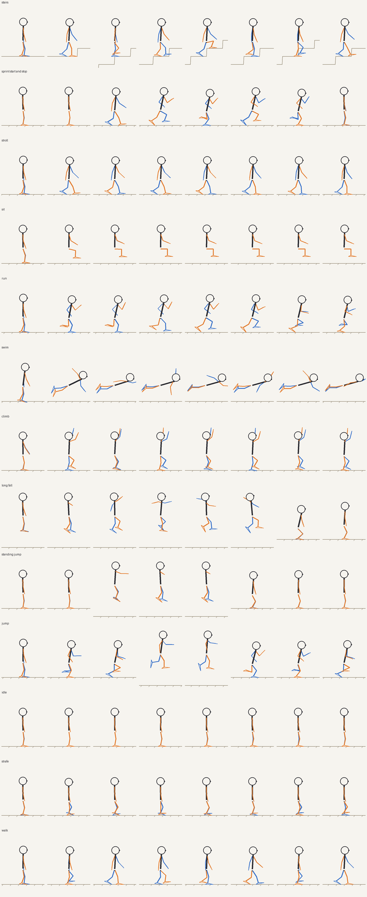
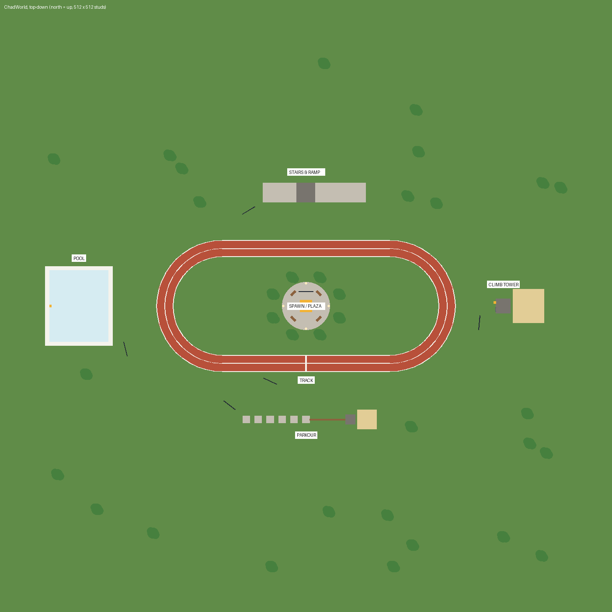

# Chad Animate V5 + Chad World

Procedural R15 animations for Roblox: walk, run, jump, fall, land, climb,
swim, sit and tool hold. It comes with a test world that has one station
for each animation, plus NPCs that demo them.



## Install (one paste)

1. Open a new **Baseplate** place in Roblox Studio.
2. **View > Command Bar**. Paste all of [`dist/ChadWorld_Installer.lua`](dist/ChadWorld_Installer.lua) and press Enter.
3. **Game Settings > Avatar**: set Avatar Type to **R15**.
4. Press **Play** (not Run).

The installer creates these:

| Where | What |
| --- | --- |
| `ReplicatedStorage.ChadConfig` | Settings (walk/run speed, foot IK, head look...) |
| `StarterPlayerScripts.ChadAnimate` (+ `Rig`, `Gait`) | The animator |
| `StarterCharacterScripts.Animate` | Empty script that turns off Roblox's default animations |
| `ServerScriptService.ChadWorld` (+ `World`, `Npcs`) | World builder and demo NPCs |
| `Workspace.ChadWorld`, Lighting | The world itself |

Running it again replaces everything it made. One Ctrl+Z undoes the whole
install. It also deletes the V4 `ChadAnimate` script from
StarterCharacterScripts. Like V4's WorldSetup, it removes the root
`Baseplate` and any root `SpawnLocation`.

### Just the animations on a Baseplate, as a dummy

To get only the walk/run animator, with no world or NPCs, paste
[`dist/ChadBaseplate_Installer.lua`](dist/ChadBaseplate_Installer.lua) in
step 2 instead. It keeps Roblox's Baseplate and spawn, and installs
`ChadConfig`, `ChadAnimate` and the empty `Animate`. It also adds a gray R15
dummy as `StarterPlayer.StarterCharacter`, so every player spawns as the
dummy, and turns off `LoadCharacterAppearance` so no clothes or accessories
load. The dummy sets its own rig type, so step 3 isn't needed. If the place
had the full world, this removes it, but it leaves Lighting alone.

If you use Rojo, `src/` follows the usual layout: `shared` goes to
ReplicatedStorage, `client` to StarterPlayerScripts, `character` to
StarterCharacterScripts, and `server` to ServerScriptService. If the place
has no `ChadWorld`, the server script builds one at startup.

## Controls

- **WASD / stick**: walk. Partial stick tilt gives a slow walk.
- **Hold Shift** (or gamepad **L3**): run. Phones and tablets get a **RUN** button.

## The world



| Station | Try |
| --- | --- |
| Plaza (spawn) | Idle and benches (sit) |
| Track | Walk, then sprint. Three NPCs lap it at stroll, walk and sprint speed. |
| Stairs & Ramp (north) | Feet land on each step; the slope tilts the stride |
| Climb Tower (east) | Truss and ladder, then a 40-stud drop onto sand (flail + hard landing) |
| Parkour (south) | Blocks, balance beam, jumps and landings |
| Pool (west) | Swim (front crawl when moving, treading water when still), then climb the truss out |

## What changed from V4

**Fixed**
- **Knees bent forward.** On R15, positive Knee X swings the shin forward, so
  V4's walk, run, jump and sit all hyperextended the knees. Knees now only
  bend backward. A test checks this for every animation.
- **Upper body twisted the wrong way.** V4 turned the chest *with* the
  leading leg. Now the pelvis turns with the leg and the chest counter-turns,
  as in a real gait.
- **Only you saw the animation.** V4 animated your own character only, so
  other players saw no animation at all. V5 runs on each client and
  animates every character it can see: other players and tagged NPCs too.
  It reads replicated physics, so it adds no network traffic.
- **Movement looked laggy.** V4 low-pass filtered the whole pose at 13/s,
  which shrank and delayed the gait. V5 cross-fades between states and
  leaves the gait itself unfiltered.

**New**
- **Two-bone leg IK.** Each foot lands on a planned spot, stays planted while
  the body passes over it, rolls heel to toe, and rests on stairs and slopes
  (one raycast per foot). It measures every avatar's legs, so blocky, Rthro
  and scaled bodies all fit.
- **Steps follow real speed.** Cadence and stride come from actual velocity,
  not from the Shift key. Walking into a wall stops the legs, and a partial
  stick tilt gives a slow walk.
- **Walk and run are different gaits.** Walking keeps a foot on the ground
  at all times. Running has a flight phase, a heel kick, bent "sprinter"
  arms, a forward lean, and a body that sinks at mid-stance.
- **Body dynamics.** Leans into acceleration, banks into turns, hips dip on
  the swing side, weight shifts over the planted foot, feet shuffle when
  turning on the spot.
- **Air.** Tuck on a standing jump, a stride leap on a running jump, legs
  reach for the ground on the way down, and windmilling arms on long drops.
  The landing crouch scales with impact speed.
- **More states.** Climb (alternating hands and feet, paced by climb speed),
  swim (crawl / tread water), sit (thighs level, shins down), and holding a
  tool (right arm forward).
- **Idle.** Breathing, slow weight shifts, glancing around. Each character
  has its own rhythm.
- **Head look.** Your head turns toward where the camera points.

## Tuning

- `ReplicatedStorage.ChadConfig`: gameplay. Walk speed is **12**, because
  Roblox's default of 16 is a jog for R15 leg length. Set it back to 16 if
  you prefer: the gait blends toward a jog by itself. Run speed, the touch
  button, foot IK, head look and LOD distances live here too.
- `ChadAnimate > Gait > STYLE`: the animation style. Lengths are in leg
  lengths, so one set of numbers fits any avatar. Examples: `RUN_LEAN`,
  `WALK_ARM`, `RUN_LIFT` (heel kick), `WALK_DUTY` / `RUN_DUTY` (time a foot
  is planted), `LANDING_DEPTH`.

## Tests and previews

Studio can't run headless here, so the scripts are checked three ways:

```bash
pip install lupa pillow
python3 tests/run_tests.py --preview
```

1. **Syntax.** All the code is written in plain Lua 5.1 syntax, a subset of
   Luau, so a Lua parser validates every file and the installer.
2. **Animation math.** The real `Gait` and `Rig` modules run in a Lua VM
   with a Roblox `CFrame`/`Vector3` implementation. Checks cover: knees
   never bend forward; planted feet hit their IK targets and stay above the
   floor; feet don't cross when strafing; walking always has a foot down
   while running has flight; arms swing against legs; landings crouch
   deeper the harder they hit; sit, tool and head-look poses. It also
   renders `preview/*.gif` stick figures (side and front view).
3. **Mock engine.** It runs the installer, the server and the client
   end-to-end against a mock Roblox. Every class, property, enum, method
   and permission is checked against Roblox's official API dump, which the
   test downloads to `tests/.cache/`. It also checks that NPCs spawn, move,
   sit and sprint, and that Shift raises WalkSpeed.

Rebuild the installer after editing `src/` with `python3 tools/build_installer.py`.

## Known limits

- **Foot slide at Roblox speeds.** For a blocky R15, 12 studs/s is about
  6.7 leg lengths per second, which is a human jogging pace. Fully planted
  feet at that speed would need about 9 steps a second. The gait caps the
  stride instead, and planted feet slide at about 45% of body speed walking
  (12) and running (24), and about 19% strolling (5). From its hip swing
  and cadence, V4's feet slid at an estimated 60-70% of body speed.
- **Shift lock.** Holding Shift to run swallows the input, so Shift no longer
  toggles shift lock (same as V4). Strafing and backpedalling animate fully
  in first person or with shift lock bound to another key.
- **Emotes** (`/e dance`) and custom AnimationTracks on the 15 R15 joints
  are overridden. Facial animation and other joints are untouched.
- **Other players' climbing and swimming.** These use the humanoid state
  replicated from that player. Water is also detected with a raycast; there
  is no fallback for climbing.
- **Sprint speed is client-side.** That is normal Roblox movement, but
  competitive games should validate it on the server.
- **Rig shape.** It assumes R15 joints with axis-aligned C0/C1, which covers
  standard and Rthro bodies. Exotic custom rigs may need STYLE tweaks.
