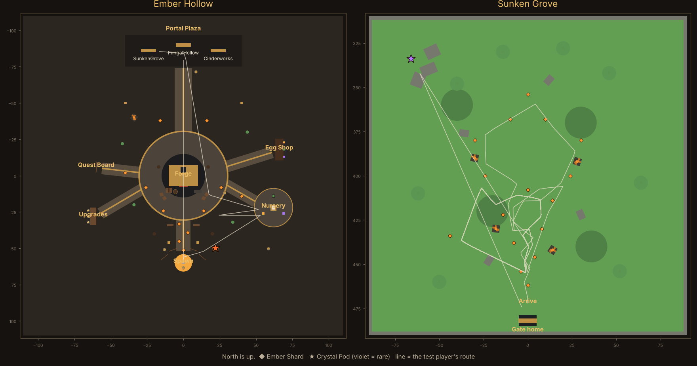

# EMBERHATCH playtest report

The finished game file (`EmberHatch.rbxlx`, with the world baked in) were run in a headless stand-in for the Roblox engine (`playtest/engine.luau`) and played from a script (`playtest/run.luau`): a test player joins, collects shards, breaks pods, hatches the starter egg, uses every portal, plays to level 5, finds Crystal Cores, leaves and rejoins. Separate players test an old Milestone 1 save, a profile still locked by another server, a crashed server's stale lock and a server shutdown. A second run plays Studio with API access off on a phone screen.

**Result: 97 checks passed, 0 failed, no script errors.** The binary `EmberHatch.rbxl` passes the same live run.

## Bugs the playtest found (fixed)

1. **Old saves kept too much XP.** A Milestone 1 player at level 3 with 150 XP showed "150 / 100" on the XP bar, because the new level curve needs less XP per level. Old saves now level up on load (that player becomes level 4 with 50 / 130).
2. **Veterans could never finish "Hatch a Forgekin".** Players who already owned Stoneback can't hatch the starter egg again, so the quest was stuck forever. Owning a Forgekin now completes it on load.

## Worth a look

- **Level 5 comes fast.** The test player reached level 5 (Fungal Hollow) about 2.5 minutes after spawning, with roughly 1 minute of Sunken Grove play: 51 shards and 8 pods. The bot walks straight to the nearest shard and never pauses, so a real player is slower, but probably not by more than 2–3×. To slow it down, lower `Shard.xp` or `Pod.xpBonus` in `src/shared/ResourceConfig.luau`, or raise the curve in `DataService.XPForLevel` (now 40 + 30 per level).
- **The first shard can be collected right at spawn.** Its prompt is already in reach where you appear (0.2 s). That beats the 10-second goal; move it a few studs north in `ResourceConfig.HubShards` if you want players to take a step first.
- **Mobile budget looks fine:** 265 parts, 18 lights, 31 particle emitters (28 are the small shard sparkles).

## What this playtest can't check

It is not Roblox. Scripts, data, events, prompts, remotes, saving and rewards are real; how things look and feel is not:

- No rendering: lighting, colors, sign readability and HUD layout on screen are untested. The map below is drawn from part positions.
- No physics: the test player walks in straight lines through walls and never jumps or falls.
- Server and client share one process, so network timing and replication delays aren't simulated.
- Studio itself, real devices and real touch input aren't involved.

Open the place in Studio once for a visual pass.

## Live server run (details)
78 passed, 0 failed, 6 minutes of play simulated.

**World**

- ✅ The place file already holds the whole world (opens complete in Studio) — 28 shards before any script ran
- ✅ Server starts with no script errors
- ✅ Ember Hollow hub is built
- ✅ Sunken Grove is built
- ✅ 28 Ember Shards placed (12 hub, 16 grove) — 28 shards
- ✅ 7 Crystal Pods placed, 1 of them rare — 7 pods, 1 rare
- ✅ Every shard and pod has a prompt — 0 missing
- ✅ Shards float above the ground, none buried — lowest 1.80 studs above ground
- ✅ 4 Forgekin NPCs wander the hub

**Joining**

- ✅ Profile loads
- ✅ Saving is on — ok
- ✅ HUD is built
- ✅ Title card reads EMBERHATCH / HATCH · FORGE · EXPLORE
- ✅ 5 starter quests listed — 5
- ✅ Spawn faces north toward the Forge
- ✅ Area panel says Ember Hollow

**First Ember Shard**

- ✅ First shard collected within 10 seconds — 0.2 s
- ✅ Ember Shards = 1 — 1
- ✅ Quest 'Collect your first Ember Shard' complete
- ✅ Quest reward: 25 coins — 25
- ✅ Shard disappears and its prompt turns off
- ✅ Client was told about the pickup
- ✅ Floating '+1 Ember Shard' text appears
- ✅ Pickup feed shows '+1 Ember Shard'
- ✅ Quest-complete toast shows
- ✅ Shard comes back after 8 seconds

**Cheating**

- ✅ Collecting a Sunken Grove shard from the hub is rejected
- ✅ Firing one shard's prompt twice pays once

**Ember Crystal Pod**

- ✅ Break needs a 1-second hold
- ✅ Pod gives 3–10 Ember Shards — 7
- ✅ Pod gives 4–12 coins — 8
- ✅ HUD totals match what the pod gave (+50 coin quest reward)
- ✅ Quest 'Break an Ember Crystal Pod' complete
- ✅ Pod disappears and stops blocking
- ✅ Pod burst effect plays
- ✅ Pod stays broken for at least 30 seconds
- ✅ Pod grows back within 30–60 seconds — 43 s

**Starter egg**

- ✅ Client plays the hatch (egg wobble + burst)
- ✅ Stoneback appears next to the player
- ✅ Saved like Milestone 1: { uid, species, rarity, level, xp }
- ✅ Stoneback is equipped
- ✅ Quest 'Hatch a Forgekin' complete, +5 gems
- ✅ Stoneback follows the player — 3.7 studs behind
- ✅ Starter egg can't be hatched twice

**Hub stations**

- ✅ Forge Station says it opens soon

**Portals**

- ✅ Fungal Hollow gate shows 'Locked · Lv 5' — Locked · Lv 5
- ✅ Locked gate refuses below level 5
- ✅ Sunken Grove gate teleports into the grove
- ✅ Player lands on the ground at the grove entrance — -0.0000076293945, 3.5, 472
- ✅ Area panel switches to Sunken Grove

**Playing to level 5 in the Sunken Grove**

- ✅ Reaches level 5 (unlocks Fungal Hollow) — 2.5 min
- ✅ Quest 'Unlock Fungal Hollow' complete, +10 gems — 15
- ✅ Fungal Hollow gate now shows 'Enter' — Enter
- ✅ XP bar text matches the server

**Rare pod and Crystal Cores**

- ✅ Rare pod gives Crystal Cores — 2 core(s) after 4 break(s)
- ✅ Crystal Cores panel updates

**Going home**

- ✅ Return gate brings the player back to Ember Hollow
- ✅ Fungal Hollow (level 5) says it opens soon

**Saving**

- ✅ Autosave wrote the profile
- ✅ Leaving saves everything
- ✅ Leaving releases the session lock
- ✅ Follower is removed when the player leaves
- ✅ Rejoining restores shards, cores and coins
- ✅ Rejoining brings Stoneback back
- ✅ Finished quests stay finished

**Old Forgekin save (Milestone 1 format)**

- ✅ Coins and gems carry over (340 / 12) — 390 coins, 17 gems
- ✅ Level carries over (3 or more) — 4
- ✅ XP is below the next level — 50 / 130
- ✅ Their Stoneback follows them
- ✅ 'Hatch a Forgekin' counts as done (they already have one)
- ✅ Removed-system data is gone from the save — 
- ✅ Forgekin and equipped list are kept

**Session lock**

- ✅ Profile still locked by another server: player is asked to rejoin — Your progress is still saving from another server. Please rejoin in a minute.
- ✅ Locked profile is left untouched
- ✅ Stale lock from a crashed server is taken over

**Server shutdown**

- ✅ Shutdown saves and unlocks everyone

**Text**

- ✅ No removed-system words in any sign, label, prompt or message

**Script health**

- ✅ No script errors during the whole session

**Numbers**

- Parts in the world: 265
- Lights: 18
- Particle emitters: 31
- Seconds from spawn to first Ember Shard: 0.2
- Walk from spawn to the starter egg (seconds at normal speed): 5
- Minutes from spawning to level 5 (includes test pauses, ~1.5 min): 3.7
- Minutes of grove play from level 1–2 to level 5: 2.5
- Shards picked up / pods broken on the way: 139 / 0

## Studio run, API access off, phone screen (details)
19 passed, 0 failed, 0 minutes of play simulated.

**World**

- ✅ The place file already holds the whole world (opens complete in Studio) — 28 shards before any script ran
- ✅ Server starts with no script errors
- ✅ Ember Hollow hub is built
- ✅ Sunken Grove is built
- ✅ 28 Ember Shards placed (12 hub, 16 grove) — 28 shards
- ✅ 7 Crystal Pods placed, 1 of them rare — 7 pods, 1 rare
- ✅ Every shard and pod has a prompt — 0 missing
- ✅ Shards float above the ground, none buried — lowest 1.80 studs above ground
- ✅ 4 Forgekin NPCs wander the hub

**Studio test, API access off, phone screen**

- ✅ Game still loads without DataStores
- ✅ …in under a second (no retry stalls) — 0.00 s
- ✅ Save mode is 'offline'
- ✅ HUD tells the player saving is off
- ✅ Only one DataStore call was tried — 1 calls
- ✅ Pickup feed sits above the jump button on touch screens — -170
- ✅ Collecting still works
- ✅ Nothing was written to a DataStore

**Text**

- ✅ No removed-system words in any sign, label, prompt or message

**Script health**

- ✅ No script errors during the whole session

**Numbers**

- Parts in the world: 265
- Lights: 18
- Particle emitters: 31

**Warnings printed by the game**

- `[t=0.00s] [DataService] Saving is off (publish the place and enable Studio API access): [string "ServerScriptService.Server.DataService"]:313: 403: StudioAccessToApisNotAllowed`
