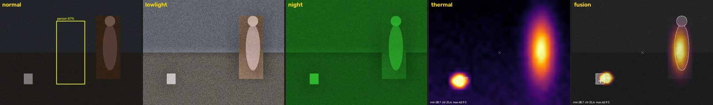
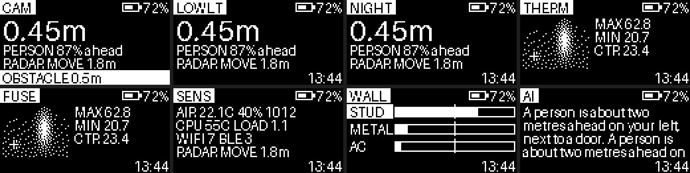
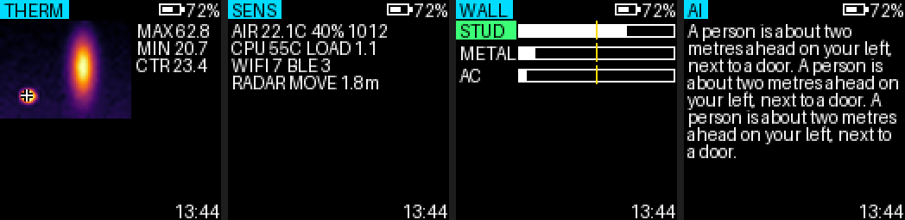

# Low-cost AI smart glasses

A buildable prototype of AI smart glasses on a **Raspberry Pi Zero 2 W**: camera with night vision and low-light enhancement, real thermal imaging, distance, radar motion sensing, passive RF awareness, a handheld wall probe, an offline voice assistant with an optional cloud vision model, and a DIY heads-up display. It uses off-the-shelf parts and open-source software.

> **Status.** The software runs end to end in simulation (`python -m glasses --sim`). The test suite (27 tests) passes, and the CPU object detector was checked on real photos. The hardware drivers are written against each vendor's Python library and datasheet, **but they have not been run on physical hardware yet**. Expect some tuning during bring-up: pin choices, image orientation and thresholds. `--selftest` is there to make that quick.

## Start here: the cheapest viable build (~€97)

| Part | Model | € |
|---|---|---|
| Computer | Raspberry Pi Zero 2 W | 19 |
| Storage | 32 GB microSD (A1) | 6 |
| Camera | OV5647 5 MP **NoIR** mini camera for Pi Zero (with cable) | 8 |
| Night illuminator | 4× 850 nm IR LEDs + BC337 transistor + resistors | 2 |
| Thermal sensor | Panasonic AMG8833 8×8 (GY-AMG8833 board) | 20 |
| HUD display | SSD1306 0.96" 128×64 I2C OLED | 3 |
| HUD optics | 50/50 acrylic beam splitter + 25 mm lens | 4 |
| Distance | VL53L0X time-of-flight | 2.5 |
| Radar | RCWL-0516 microwave motion sensor | 1 |
| Microphone | INMP441 I2S MEMS | 2.5 |
| Amplifier + speaker | MAX98357A I2S amp + 20 mm 8 Ω speaker | 4 |
| Power monitor | INA219 | 2 |
| Controls | 2 buttons, privacy LED, resistors | 1 |
| Frame | cheap safety glasses/sunglasses | 4 |
| Mounting | wire, perfboard, connectors, heat-shrink, tape | 6 |
| Power | 5000 mAh slim power bank (pocket) + 1 m cable | 12 |
| **Total** | **≈ €97** (≈ €85 if you already own a power bank) | |

Software costs nothing. The optional cloud assistant is billed per question, at roughly €0.01 per question with the default model (see [docs/HARDWARE.md](docs/HARDWARE.md#software-costs)).

**What this build can really do**

- **Live camera feed:** 640×480 at 15 fps to your phone's browser, with up to 4× zoom done on the sensor (crop before scaling).
- **Night vision:** active near-infrared. The NoIR camera plus 850 nm LEDs light the scene to about 2–3 m in total darkness. The image is black and white (shown in phosphor green).
- **Low-light enhancement:** software only (frame averaging, gamma, local contrast). It helps in dim light and cannot work in total darkness.
- **Thermal sensing:** an 8×8 heat grid, smoothed for display. It finds people and hot objects (stove, mug, radiator) to about 5 m and reads spot temperatures to ±2.5 °C. It is real heat sensing, but **not** a detailed thermal picture. The MLX90640 (+€25) is the single best upgrade.
- **Distance** to about 1.2–2 m indoors. **Radar:** "something is moving" yes or no, to about 5 m, with no distance. **RF:** counts of Wi-Fi networks and BLE devices nearby, with signal strength.
- **On-device object recognition:** 80 everyday object types, about one detection per second, run when you ask.
- **Voice:** offline push-to-talk commands ("thermal mode", "how far", "zoom in", "describe"). Spoken answers come from espeak-ng. Free-form questions about what you're looking at go to the cloud model, with the camera image, when you have Wi-Fi (for example a phone hotspot).
- **HUD:** a 128×64 monochrome display reflected into your eye. It shows the mode, distance, temperatures, alerts, battery level and the AI answer.
- **Battery and system status:** energy-counted power bank level, runtime estimate, CPU temperature and under-voltage warning.
- **Runtime and weight:** about 5–7 h on a 5000 mAh power bank. About 70–90 g on your head (the battery stays in your pocket).

The mid-range (~€195) and advanced (~€530) builds, with every price, store and cheaper alternative, are in **[docs/HARDWARE.md](docs/HARDWARE.md)**.

## What it looks like (simulation output)

Camera view modes, as shown on the phone dashboard:



HUD pages on the 128×64 mono OLED (ultra build) and the 128×128 colour OLED (mid and advanced builds):





## Try it now on a laptop (no hardware)

```bash
cd smart-glasses
python3 -m venv .venv
```

```bash
.venv/bin/pip install -r requirements-dev.txt
```

```bash
.venv/bin/python -m glasses --sim
```

Open the `dashboard: http://...?t=<token>` link from the log, replacing `<glasses-ip>` with `localhost`. You can switch modes, zoom, and type questions or commands. Set `ANTHROPIC_API_KEY` to try the cloud assistant. Run the tests with `.venv/bin/python -m pytest`.

## Documentation

| Document | Contents |
|---|---|
| [docs/HARDWARE.md](docs/HARDWARE.md) | Shopping lists for all three builds, prices, stores, alternatives, budgets, feature matrix |
| [docs/WIRING.md](docs/WIRING.md) | Connection diagram, pin map, I2C addresses, power wiring |
| [docs/SOFTWARE.md](docs/SOFTWARE.md) | Architecture, folder structure, installation, configuration, voice commands, AI setup |
| [docs/BUILD_AND_TEST.md](docs/BUILD_AND_TEST.md) | 7-stage roadmap, assembly, test procedures, upgrades |
| [firmware/wall_probe](firmware/wall_probe/wall_probe.ino) | ESP32 handheld wall probe (mid and advanced builds) |

## Honest limitations

- **Thermal imaging is not night vision.** Thermal sensors (AMG8833, MLX90640, P2 Pro) measure long-wave infrared (8–14 µm) that objects emit themselves. They work in total darkness, but **glass and most plastics block that light**, so the sensor needs an open window in the frame and cannot sit behind a lens. "Night vision" here means a NoIR camera that sees reflected 850 nm light from our own LEDs. "Low light" means software amplification of whatever visible light there is.
- **Radar does not see through walls.** RCWL-0516 and LD2410/LD2450 modules report motion, presence and distance of moving or breathing bodies. Their microwaves pass through thin drywall, wood and plastic, so they can react to motion behind them, but they produce no image and cannot map what is inside a wall.
- **Wall sensing needs contact and gives hints.** The handheld probe senses density changes (studs), ferrous metal (screws, steel pipes) and live AC fields within about 2–3 cm of the surface. It misses plastic pipes and deep or shielded cables. It is not a safety device: switch the circuit off and use a certified detector before you drill. The thermal camera can also show studs, hot-water pipes and damp patches when there is a temperature difference. That is surface temperature, not seeing through the wall.
- **RF sensing is passive and aggregate.** It counts and measures signal strength only. It never decodes traffic and never stores device addresses.
- **Compute is small.** On-device detection runs at about 1 fps on the CPU, or about 30 fps with the Pi AI Camera. The cloud assistant needs a network, adds 2–6 s of latency, costs money per question, and sends the current image off the device.
- **The DIY HUD is basic.** It is low resolution, has a narrow field of view and is hard to read in direct sun. It is not a commercial waveguide display.
- **Heat and weight.** A Pi Zero 2 W runs at 60–70 °C under load. Keep it insulated from skin (wearables should stay below about 43 °C where they touch you). The software halves its workload above 75 °C.
- **Privacy and law.** This project deliberately does no face recognition or identification of people. An outward LED lights whenever the camera runs. Recording people, especially audio and in private spaces, is regulated (GDPR in the EU; in Germany, §201 and §201a StGB). Tell people when you record, and switch the glasses off where cameras are not welcome.
