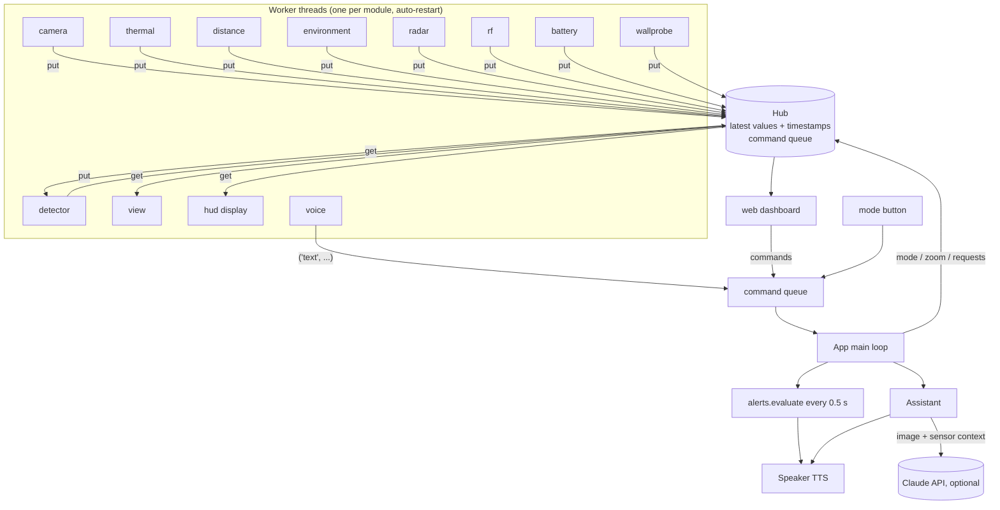

# Software

## Languages

| Where | Language | Why |
|---|---|---|
| Glasses (Pi Zero 2 W) | **Python 3.11+** | Every sensor has a maintained Python driver (Adafruit CircuitPython via Blinka, picamera2, luma). OpenCV and NumPy do the heavy lifting in C. Easy to modify. |
| Wall probe (ESP32) | **C++ (Arduino)** | Microsecond-timed ADC sampling for the 50 Hz detector; no OS needed |
| Dashboard | HTML + a few lines of JavaScript | Served by Python's standard library; any phone browser works |

## Folder structure

```
smart-glasses/
├── README.md                    overview, cheapest build, limitations
├── requirements-pi.txt          pip packages for the Pi
├── requirements-dev.txt         laptop simulation + tests
├── configs/
│   ├── ultra.toml               copy one of these to ./config.toml
│   ├── mid.toml
│   └── advanced.toml
├── glasses/                     the application (python -m glasses)
│   ├── __main__.py              App: starts workers, handles commands, alerts, thermal governor
│   ├── default_config.toml      every setting with its default (= ultra build)
│   ├── config.py                loads defaults + your overrides, --sim switch
│   ├── hub.py                   shared state store + Worker base class (error handling)
│   ├── alerts.py                alert policy (obstacle, hot surface, live AC, battery...)
│   ├── text.py                  state → spoken sentences / AI context / offline answers
│   ├── web.py                   phone dashboard: MJPEG video, HUD preview, JSON, commands
│   ├── sensors/
│   │   ├── thermal.py           AMG8833 · MLX90640 · InfiRay P2 Pro · sim
│   │   ├── distance.py          VL53L0X · VL53L1X · TF-Luna · sim
│   │   ├── environment.py       BME280 · BME680 · sim
│   │   ├── radar.py             RCWL-0516 · LD2410 · LD2450 (frame parsers) · sim
│   │   ├── rf.py                Wi-Fi/BLE counts · RTL-SDR spectrum · sim
│   │   ├── battery.py           INA219 (power bank or LiPo) + CPU temp/throttling
│   │   └── wallprobe.py         UDP receiver + stud/metal/AC classification
│   ├── vision/
│   │   ├── camera.py            picamera2 · IMX500 AI camera · USB webcam · sim; zoom, IR LEDs
│   │   ├── enhance.py           low light, night, thermal colour map, fusion, zoom
│   │   ├── detect.py            SSD-MobileNet-v2 (OpenCV DNN) object detection
│   │   └── view.py              builds the processed view for the dashboard
│   ├── ai/
│   │   ├── voice.py             Vosk speech-to-text, command parser, espeak/Piper TTS
│   │   └── assistant.py         Claude vision assistant (+ offline fallback)
│   └── hud/
│       ├── render.py            draws the HUD pages with Pillow
│       └── display.py           pushes frames to SSD1306/SH1106/SSD1351/ST7789
├── firmware/wall_probe/wall_probe.ino
├── scripts/
│   ├── install.sh               one-time Pi setup
│   ├── download_models.sh       offline speech + detection models
│   └── smart-glasses.service    systemd unit (autostart)
├── tests/                       pytest: parsers, processing, HUD, full sim run
└── docs/
```

## Architecture



**How it works**

- **One thread per module.** Each sensor or output is a `Worker` with `setup()` (open the device) and `step()` (one read or one frame). Workers never call each other. They publish to and read from the `Hub`, a lock-protected dictionary of latest values with timestamps.
- **Failures stay contained.** If `setup()` fails (sensor not plugged in, library missing), the worker reports `unavailable: <reason>` and retries every 30 s, so hot-plugging works. If `step()` raises, the worker closes the device and restarts with exponential backoff (1 s → 30 s). Everything else keeps running. Statuses show in the dashboard and `/state.json`.
- **Stale data is hidden.** `Hub.snapshot()` drops values older than 10 s, so a dead sensor shows "--" instead of a frozen, misleading number.
- **Commands** from voice, the dashboard and buttons are queued and handled in one place (`App.handle`), so there are no races over mode and zoom.
- **Power and heat:** the object detector runs only on request by default. The dashboard video is only encoded while someone watches. Above `cpu_throttle_c` (75 °C) the camera view and detector halve their rate. Push-to-talk keeps speech recognition idle until you press the button.
- **Simulation:** every module has a `sim` driver, so the whole system, including the web dashboard, runs on a laptop with `--sim`.

### Data published to the hub

| Key | From | Content |
|---|---|---|
| `frame` | camera | BGR image (640×480) |
| `thermal`, `thermal_stats` | thermal | °C array; min/max/mean/centre, hotspot position |
| `distance` | distance | metres or `None` |
| `environment`, `ambient_c` | environment, AMG8833 | air temperature/humidity/pressure/gas |
| `radar` | radar | presence, moving, still, distance_m, targets |
| `rf` | rf | wifi_count, wifi_best_pct, ble_count, ble_best_dbm, sdr_* |
| `battery`, `system` | battery | soc, volts, current_ma, power_w, runtime_h; cpu_c, throttled, undervolt |
| `wall` | wallprobe | cap/mag/ac deltas, levels, stud/metal/live_ac flags |
| `detections` | detector or AI camera | label, score, box |
| `alerts`, `ai_answer`, `mode`, `zoom` | app | |

## Installation on the Pi

1. **Flash the OS.** In Raspberry Pi Imager choose *Raspberry Pi OS Lite (64-bit)*. Under OS customisation, set a hostname (`glasses`), a user, your Wi-Fi (for example your phone hotspot) and enable SSH.
2. **Copy the project and install** (about 20 minutes on a Zero 2 W):

   ```bash
   ssh <user>@glasses.local
   ```

   ```bash
   git clone https://github.com/DominicsUSE/Claude-apps.git && cd Claude-apps/smart-glasses
   ```

   ```bash
   ./scripts/install.sh && sudo reboot
   ```

3. **Download the offline models** (about 110 MB):

   ```bash
   cd ~/Claude-apps/smart-glasses && ./scripts/download_models.sh
   ```

4. **Pick your build:** `cp configs/mid.toml config.toml` (install.sh already copied `ultra.toml`). Edit any values.
5. **Check every module:**

   ```bash
   .venv/bin/python -m glasses --selftest
   ```

   Each line reads `OK` or `FAIL: <reason>`. The reasons are written to be actionable (wrong address, missing library, missing model).
6. **Run it** in the foreground first:

   ```bash
   .venv/bin/python -m glasses
   ```

7. **Autostart on boot:**

   ```bash
   sudo systemctl enable --now smart-glasses
   ```

   Read the log with `journalctl -u smart-glasses -f`. The log also prints the dashboard link with its access token.

**Memory tip (512 MB RAM):** the Vosk model, OpenCV and the camera fit, but there is little headroom. Keep the OS Lite (no desktop) and leave swap/zram at the default or larger.

## Configuration

All settings are listed with comments in [`glasses/default_config.toml`](../glasses/default_config.toml). Your `config.toml` only needs the values you change. The most important ones:

| Setting | Meaning |
|---|---|
| `[<module>] driver` | which hardware, `sim`, or `none` to disable |
| `[thermal] flip_h/flip_v` | match the thermal image orientation to the camera |
| `[thermal] fusion_scale/offset_x/offset_y` | line up the thermal overlay with the camera (calibrate on a hot mug at 2 m) |
| `[hud] mirror` | `true` for a beam splitter (the reflection is mirrored) |
| `[voice] trigger` | `button` (push-to-talk) or `wake_word` ("glasses ...") |
| `[assistant] model / effort` | cloud model and reasoning effort (see costs in HARDWARE.md) |
| `[alerts] ...` | obstacle distance, hot-surface temperature, low-battery level |
| `[wallprobe] *_threshold` | sensitivity of the stud/metal/AC hints |

## Using it

**Buttons:** hold GPIO17 and speak. Press GPIO27 to cycle modes: `normal → lowlight → night → thermal → fusion → sensors → wall → ai`.

**Voice commands** (offline):

| Say | Does |
|---|---|
| "thermal" / "heat" · "fusion" / "overlay" · "night" · "low light" · "normal" · "sensors mode" · "wall mode" | switch mode |
| "zoom in" · "zoom out" · "reset zoom" | 1.5× steps, up to 4× |
| "lights on" / "lights off" | IR illuminator override |
| "how far" · "battery" · "temperature" · "status" | spoken readings |
| "describe" · "what do you see" | detector + cloud description of the scene |
| "calibrate" | re-baseline the wall probe (hold it on a bare wall) |
| "battery full" | reset the power-bank energy counter after charging |
| "take a photo" | saves a JPEG to `~/glasses-captures` |
| anything else | sent as a question to the assistant, with the current image |

**Dashboard:** open the link from the log on your phone (same network). It shows the processed live view, a HUD preview, all sensor values and module statuses, mode buttons and a command box. Every request needs the token, because without it anyone on the network could watch your camera. Set a fixed token in `[web] token`, or set `enabled = false` to turn the dashboard off.

## AI assistant

- **On device, always:** object detection (SSD-MobileNet-v2, COCO), speech recognition (Vosk) and speech output (espeak-ng/Piper). These work offline.
- **Cloud, optional:** put `ANTHROPIC_API_KEY=sk-ant-...` in `.env` (chmod 600; it is git-ignored). For each question the glasses send **one** downscaled camera image, a short summary of the sensor readings, and the last three questions and answers as text. Nothing is sent in the background.
- The system prompt keeps answers to two short spoken sentences, describes people only generically, and gives cautious advice on safety topics.
- If a safety classifier declines a request, the API retries it on Anthropic's recommended fallback model (`fallbacks: "default"`). If it still declines, the glasses say "I can't help with that one."
- Without network or credits, the glasses answer from their own sensors, for example: "I see a person ahead, a cup on the right. Nearest obstacle 1.2 meters."

## Running on a laptop

```bash
pip install -r requirements-dev.txt
```

```bash
python -m glasses --sim
```

```bash
python -m pytest
```

`--sim` replaces every driver with a simulator: a dim synthetic room, a walking warm figure, a hot mug that comes and goes, a wall probe sliding over studs and a live cable. To use a real USB webcam instead, run with a config that sets `[camera] driver = "opencv"`.
