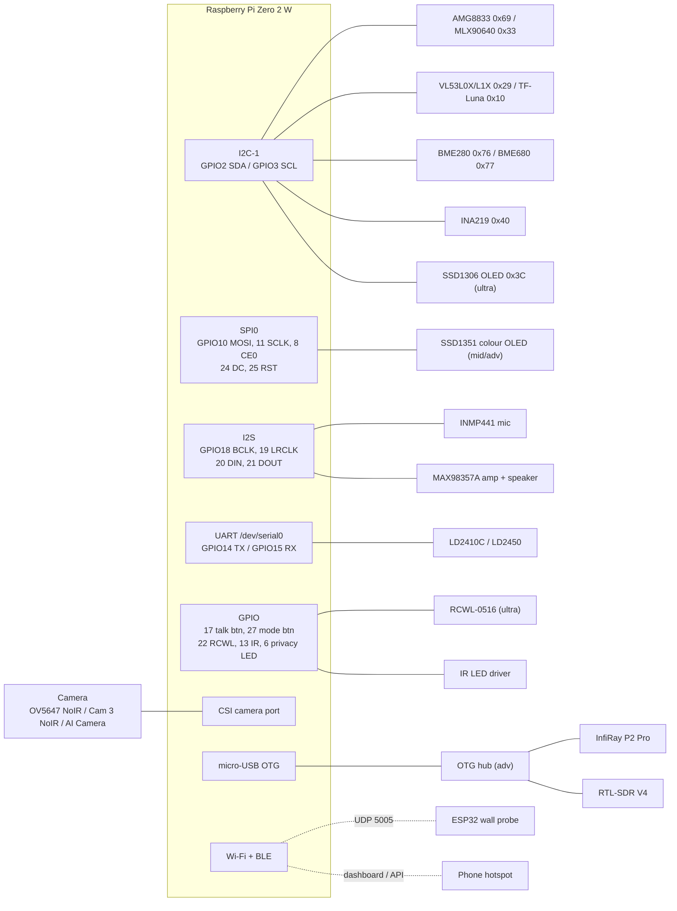

# Wiring

Check these against your own boards: cheap modules sometimes print their pins in a different order. Wire everything on a breadboard first, then run `python -m glasses --selftest`, and only then solder.

## Connection diagram



## Pin map (40-pin header)

| Pin | GPIO | Connects to | Build |
|---|---|---|---|
| 1, 17 | 3V3 | VCC of all I2C modules, INMP441, SSD1351, INA219 | all |
| 2, 4 | 5V | MAX98357A Vin, radar VCC, IR LEDs, **power input** (see below) | all |
| 6, 9, 14, 20, 25, 30, 34, 39 | GND | all grounds | all |
| 3 | 2 (SDA) | SDA of thermal, ToF, BME, INA219, SSD1306 | all |
| 5 | 3 (SCL) | SCL of the same | all |
| 8 | 14 (TXD) | radar RX | mid, adv |
| 10 | 15 (RXD) | radar TX | mid, adv |
| 11 | 17 | push-to-talk button → GND | all |
| 13 | 27 | mode button → GND | all |
| 15 | 22 | RCWL-0516 OUT | ultra |
| 12 | 18 | INMP441 SCK + MAX98357A BCLK | all |
| 35 | 19 | INMP441 WS + MAX98357A LRC | all |
| 38 | 20 | INMP441 SD (mic data in) | all |
| 40 | 21 | MAX98357A DIN (audio out) | all |
| 19 | 10 (MOSI) | SSD1351 DIN | mid, adv |
| 23 | 11 (SCLK) | SSD1351 CLK | mid, adv |
| 24 | 8 (CE0) | SSD1351 CS | mid, adv |
| 18 | 24 | SSD1351 DC | mid, adv |
| 22 | 25 | SSD1351 RST | mid, adv |
| 33 | 13 | IR LED driver (via 470 Ω) | ultra, mid |
| 31 | 6 | privacy LED (via 330 Ω) | all |
| 36 | 16 | leave free: the voicehat overlay may claim it (amp enable) | – |

Module-side notes:

- **INMP441:** tie L/R to GND (left channel). VDD to 3.3 V only.
- **MAX98357A:** leave GAIN unconnected (9 dB) and SD unconnected (the board's pull-up keeps the amp on).
- **AMG8833 / VL53L0X / BME280 / INA219 boards** usually have their own regulator and pull-ups. Power them from **3.3 V**, never 5 V, so the pull-ups stay at Pi-safe levels.
- **LD2410C / LD2450:** VCC = 5 V. Their TX/RX are 3.3 V logic, so connect directly.
- **RCWL-0516:** VIN = 5 V. OUT is 3.3 V, so connect directly.

## IR illuminator driver (ultra and mid)

GPIO pins can supply only a few mA, so a transistor switches about 100 mA of LED current from 5 V:

```
 5V ──┬── 39Ω ──▶|──▶|──┐        ▶| = 850 nm IR LED (Vf ≈ 1.5 V, 50 mA)
      └── 39Ω ──▶|──▶|──┤
                        │ C
 GPIO13 ── 470Ω ──┬── B  BC337 (NPN)
                  │     │ E
               100kΩ    │
                  │     │
 GND ─────────────┴─────┘
```

Point the LEDs forward, beside the camera. Low-power 5 mm LEDs are eye-safe at normal distances. Do not swap in high-power IR emitter boards and aim them at people's faces close up.

## Privacy LED

`GPIO6 ── 330Ω ──▶|── GND` (red 3 mm LED facing outward). It lights whenever the camera runs.

## Power wiring

### Ultra: pocket power bank, INA219 counts energy

```
 Power bank 5V ──USB cable──▶ INA219 VIN+ ──shunt──▶ VIN- ──▶ Pi pin 2 (5V)
 Power bank GND ─────────────────────────────────────────────▶ Pi pin 6 (GND)
 INA219 VCC ◀── 3.3V    INA219 SDA/SCL ◀──▶ I2C bus
```

Feeding 5 V into the header bypasses the Pi's input fuse. Use a reputable power bank and a cable of at least 24 AWG for the power wires (thin data cables cause under-voltage warnings). Alternatively, cut a USB cable and put the INA219 in its red wire, keeping the micro-USB input.

### Mid: on-head LiPo, INA219 reads the cell

```
 LiPo + ──▶ INA219 VIN+ ──shunt──▶ VIN- ──▶ IP5306 BAT+
 LiPo − ──────────────────────────────────▶ IP5306 BAT−
 IP5306 5V OUT ──▶ Pi pin 2     IP5306 GND ──▶ Pi pin 6
 IP5306 USB-C ◀── charger
```

Use a LiPo with a protection board. Never charge it unattended while you wear it, and keep it away from the Pi's heat.

### Advanced: UPS HAT plus power bank

The Waveshare UPS HAT (C) mounts under the Zero (pogo pins) and has its own INA219 at **0x43**. The power bank feeds the HAT's input, so you can swap banks without a reboot.

## Physical layout (suggested)

```
            ┌────────────── front frame ──────────────┐
  privacy ● │ [IR][IR] [CAMERA] [THERMAL] [ToF] [IR][IR]│ radar on the bridge or a temple
            └──┬───────────────────────────────────┬──┘
    left temple│                                   │right temple
   ┌───────────┴─────────┐               ┌─────────┴──────────┐
   │ Pi Zero 2 W + INA219 │               │ OLED → lens → beam │ (splitter angled 45°
   │ (insulated pod)      │               │ splitter over eye  │  in front of the eye)
   │ mic near hinge       │               │ speaker near ear   │
   └──────────┬───────────┘               └────────────────────┘
              └── thin cable to pocket power bank (ultra) / neck pod (adv)
```

- The thermal sensor needs a clear opening: **glass and normal plastic block thermal infrared.**
- Keep the BME280 away from the Pi and the battery, or it measures their heat.
- Keep I2C wires under about 30 cm, and SPI under about 20 cm at 16 MHz (lower `spi_hz` for longer runs). CSI ribbons work to about 50 cm for a neck pod.
- Add strain relief (hot glue, heat-shrink) wherever a wire crosses the hinge.

## Wall probe (ESP32 DevKit V1)

| ESP32 pin | Connects to |
|---|---|
| GPIO4 (T0) | copper-tape pad (about 3×3 cm) on the probe face, covered with one layer of tape |
| GPIO34 | 15 cm antenna wire along the probe face, plus 10 MΩ to GND |
| GPIO21 / GPIO22 | GY-271 SDA / SCL |
| 3V3 / GND | GY-271 VCC / GND |
| USB port | 5 V from any USB power bank, or an 18650 cell on a €2 "power bank" charge/boost board. A bare LiPo on VIN is too low for the on-board regulator. |

Flash `firmware/wall_probe/wall_probe.ino` after you set your Wi-Fi name and password.
