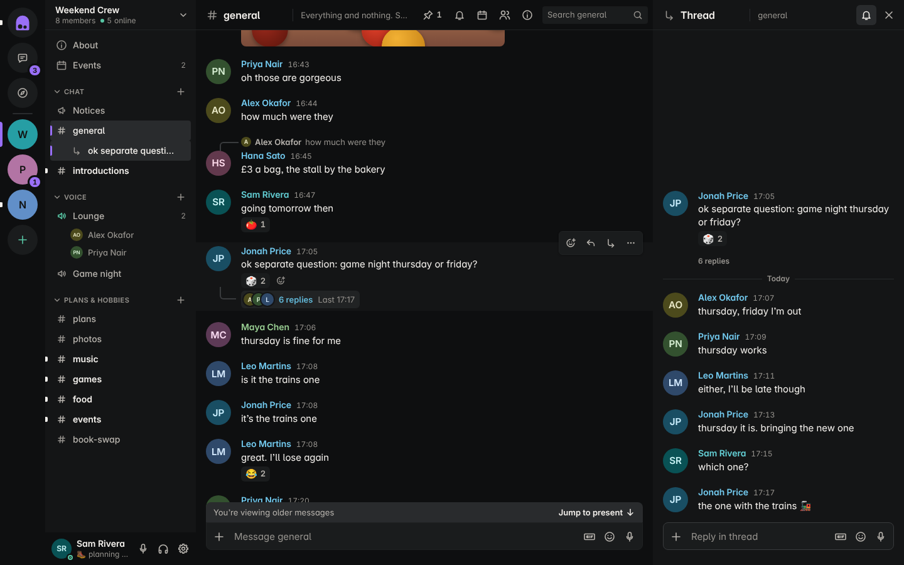

# Snug

A calm place for your people. Houses (communities) hold rooms, rooms hold
conversations, and any message can grow a thread. Direct messages, groups,
voice rooms, roles, search, saved messages and a single place to catch up.
Real accounts, a real database, live delivery between people.



## Run it

Snug is a real multi-user app: a Node server, a SQLite database and a
WebSocket connection per open tab. It needs Node 22.13 or newer.

```bash
cd snug
npm install
npm start
```

Then open http://127.0.0.1:8787 and create an account. A new account starts
empty: create a house, then invite people with a link.

To start with the sample houses and people instead:

```bash
npm run seed
npm start
```

Sign in as `robin` (or `ines`, `tomasz`, `priya`, `jonas`, `bex` and others)
with the password `snug-demo-1`. Robin has friends (one request waiting each
way), two public houses to find in Discover and three events: one on now, one
tonight and one next week, all timed from when you seed. Open a second browser profile or a private
window and sign in as someone else to talk to yourself. `npm run seed --
--force` wipes the database and loads the sample data again.

Tests:

```bash
npm test            # rules (19) and the server with real sockets (53)
npm run test:e2e    # separate people in separate browsers (49), needs Playwright
```

`test:e2e` runs every `tests/e2e*.test.js` one file at a time: the core
flows (23), calls in direct messages and groups (6), camera and screen
sharing (9), voice messages, pins and GIFs (4), custom emoji (3) and
notifications when Snug is closed (4). Each also runs alone: `npm run
test:e2e:calls`, `test:e2e:video`, `test:e2e:messages`, `test:e2e:emoji`,
`test:e2e:notify`. The notifications file uses Playwright's newer headless
Chromium (`channel: 'chromium'`).

## The desktop app

Snug also ships as a Windows app (`desktop/`): one file to install or run,
with the server inside it. Every change to `snug/` builds it on GitHub's
Windows machines (`.github/workflows/build-snug-windows.yml`), runs Snug's
tests there, and drives the packaged app before publishing:

- Open **Actions > Snug Windows app**, pick the latest run and download
  **Snug-Windows-Installer** (Start menu and desktop shortcuts) or
  **Snug-Windows-Portable** (one `.exe` that runs without installing).
- Builds on the default branch also publish both as a release (`snug-v<version>`).

The app is not code-signed, so the first time Windows may show "Windows
protected your PC": click **More info**, then **Run anyway**.

On first run it asks where Snug should run:

- **On this computer.** The server runs inside the app and the database
  lives in your app-data folder (**Snug > Open the data folder**). Switch on
  *Let people on my network join* and others on the same Wi-Fi can open the
  address from **Snug > Copy the address for other people**, in a browser or
  in their own Snug app. Over that plain address they can write but not use
  voice, because browsers only allow the microphone on secure pages.
- **Join a Snug.** Type the address of a Snug that someone else runs.

**Snug > Change where Snug runs** brings the choice back.

Closing the window keeps Snug running in the system tray (the menu bar on a
Mac), so its connection stays open and notifications keep arriving; the
first close says so. The tray menu has **Open Snug** and **Quit**; Quit stops
the server and closes the database cleanly. Turn this off with **Snug > Keep
Snug running when the window is closed** or the same switch in Settings >
Notifications (stored in `desktop.json`). Opening Snug again while it runs in
the tray brings the window back. Clicking a notification shows the window on
the conversation. Tested under Xvfb on Linux (the window hides, the server
keeps answering, a message from a second person notifies and the click
opens it, tray Quit exits); the tray icon itself and the system's
notification banner were not looked at on a real Windows or Mac desktop.
An incoming call brings the window up, from the tray too, without taking
the focus from whatever you are typing in, flashes it in the taskbar and
shows a system notification ("Lou Brandt is calling") that closes when the
ring stops; the window then shows the incoming-call screen. Tested under Xvfb (the hidden
window comes back, the notification is recorded, the screen shows and goes
when the caller gives up); the banner itself was not seen.

To work on the app:

```bash
cd snug/desktop && npm install && npm start
```

```bash
npm test    # drives the real app window; on Linux run it under xvfb-run -a
```

## What is real, and what is not yet

Real, and covered by tests with separate users:

- Accounts, sign-in, sign-out, sign out everywhere, password change.
- Houses, rooms, roles and permissions, invitations by link and by username,
  member removal, newcomer onboarding.
- Messages, replies, threads, edits, deletes with undo, reactions, file and
  picture uploads. All stored in the database and delivered live.
- Direct messages and groups, with friends or people you share a house with.
- Friends: requests by username, accept, decline, remove, private favourites.
  Friends see each other's presence without sharing a house.
- Discovery of public houses (by topic or name) and of people you are
  connected to through a house or a mutual friend; joining a public house
  without an invitation.
- Events in houses, with who is going, live to everyone in the house.
- Presence from real connections, typing notices, unread state and saved
  messages synced across a person's devices.
- Search over every stored message a person may read.
- In-app notes and desktop notifications while a tab is open.
- Notifications when Snug is closed (Settings > Notifications > *Notify me
  when Snug is closed*): Web Push through the browser's own push service, with
  a service worker at `/sw.js`. The server keeps one VAPID key per data
  folder, encrypts each note to the device (RFC 8291 aes128gcm, RFC 8292
  VAPID, node:crypto only), and sends one only for what needs you (direct
  messages, mentions, replies, followed threads; never muted places or while
  Focused) and only while none of your Snug tabs is connected, at most five
  at once then one every 20 seconds. One notification per conversation;
  clicking opens it in an open Snug tab or a new one. Signing out removes the
  device. Tested against a local mock push service (decrypting each push and
  checking its signature) and with Chromium's real service worker
  (`npm run test:e2e:notify`); delivery
  through Google's push service could not be reached from the test machine,
  so a real Chrome or Firefox push has not been seen end to end.
- Voice rooms: real audio between people over WebRTC. The server only
  introduces them to each other.
- Camera and screen sharing in voice rooms, on the same peer-to-peer
  connections: camera at 640x360 to 1280x720, screen share with its sound
  where the browser offers it, stopped by the browser's own "Stop sharing".
  Someone joining late gets what is already on. Screens take the large tile
  with the rest in a strip; click any tile to make it large; full screen for
  a shared screen. The desktop app answers a screen share with its own picker
  of screens and windows. Tested with Chromium's fake camera and screen
  (`npm run test:e2e:video`) and in the desktop app under Xvfb; real cameras,
  and system sound (Windows only, in the desktop app), have not been tested
  here. Not tested either: the browser's own "Stop sharing" bar (headless
  Chromium has none, so the test ends the track instead), the macOS system
  picker, full screen actually filling the screen (only the button is
  checked), and the desktop video test on the Windows build machines. Video
  rides the same mesh as audio, with bitrate capped as the room grows, so more
  than a few cameras at once will strain it.
- Calls in direct messages and groups: the phone and camera buttons in a
  conversation's header start a voice or video call, on the same WebRTC
  code as voice rooms (a call is a voice place keyed by the conversation),
  with the same stage: tiles, camera, screen share, mute, deafen, hang up.
  Starting one rings everyone else in the conversation on every device they
  have open: an incoming-call screen with the caller's circle, name, *Voice
  call* or *Video call*, **Accept** (mint), **Accept with video** and
  **Decline**, a ringtone made with WebAudio (no sound files) that stops on
  any outcome, Enter to accept and Esc to decline (outside text fields: a
  ring never takes the focus from the composer, so a message being typed
  keeps its Enter and Esc), announced to screen readers, a bottom sheet on
  a phone. If the microphone can't start, nothing is sent and the call
  keeps ringing, so the incoming screen comes back. Picking up on one device stops the
  ring on the others ("You answered on another device"). A ring lasts 30
  seconds. In a one-to-one call, Decline or no answer ends it for the caller
  with *Declined* or *No answer* and Call again; in a group the others keep
  ringing until their own timeout and the call goes on while anyone is in
  it, with a *Call in progress* strip and Join for anyone not in it. Someone
  already in a call (or a voice room) still sees the ring, and accepting
  moves them: one live call per person. Calling, joining or joining a voice
  room from inside a call asks first, saying whether the call ends (one to
  one) or goes on without you (a group). A conversation set to Nothing, or
  being Focused, shows the call without a ringtone. The conversation gets
  records written by the server: *Missed call*, *Declined call* or *Call ·
  4m 12s* with who started it, shown as system lines that nobody can edit,
  delete, react to, pin or thread off. A missed call counts as needing you
  (even in a group set to Only what needs me, on the badge and in push);
  calls you took part in or declined are history, shown as quiet lines and
  never counted. A record doesn't move anyone's read marker, so messages
  sent before or during the call stay unread. Conversations with a live call carry a mint phone mark in
  the lists, and the dock at the bottom of the column shows the call and
  takes you back to it. With Snug closed, the callee's devices get a push,
  "Name is calling", that opens the conversation and stays on screen until
  the ring stops; then it is replaced by a quiet note (*Missed call*, *You
  answered on another device*) and the missed call record, if any. Up to 12 people in a call (a group holds at most
  10). Starting calls is limited to four at once, then one every 15
  seconds. Tested with real sockets (`npm test`) and in Chromium with its
  fake microphone and camera (`npm run test:e2e:calls`, with the ring
  shortened to 5 seconds by `SNUG_RING_MS`, which only the test runner
  honours). Not tested: the ringtone actually being heard (the test checks
  it starts and stops), a browser notification for a ring in a background
  tab, a ring push arriving through a real push service (only the mock), a
  12-person call, and calls on real phones and networks. Snug has no way to
  block a person yet, so there is nothing for calls to respect beyond
  muting and Focused.
- Offline: the app opens from a copy on the device, what you write waits,
  and it sends once when the connection is back.
- Voice messages: hold the microphone to record (or tap to start and tap
  Send), up to 5 minutes, with a live timer and level meter; Esc (or sliding
  left on a phone) cancels. They play in a compact row with a waveform, seeking
  and 1x, 1.5x, 2x. Audio types are checked against the file's bytes, and
  files answer Range requests so playback can seek. Recorded and played back
  in Chromium with its fake microphone (`npm run test:e2e:messages`); sliding
  left to cancel on a phone and pausing when scrolled away are built but have
  no automated test.
- Pinned messages: up to 50 per room or conversation, pinned by roles with
  the Pin messages or Remove messages permission (anyone in a direct
  conversation or group), live to everyone who can read, listed from the pin
  in the header. Someone who joins a house sees its pins from their next
  sync, not at once.
- GIFs: star any GIF to keep it in Your GIFs on every device, and pick from
  GIFs posted in your places. Search is optional (see `SNUG_GIF_PROVIDER`);
  a GIF picked from search is downloaded by the server and stored as a Snug
  file, so no message loads from another site. Tested against a local stand-in
  for the provider, not against Tenor itself.
- Custom emoji per house: up to 100, added in House settings > Emoji by roles
  with the Manage emoji permission (PNG, GIF or WebP, up to 256 KB and 256 by
  256 pixels, checked from the file on the server). Type `:name:` (with
  suggestions after two letters) or pick them from their house's section of
  the emoji picker; they work in messages and reactions, live to everyone. Used
  in a direct message, the people there see them too; a removed emoji reads as
  its `:name:`. Images are served only to people allowed to see them.
  `npm run test:e2e:emoji` drives it with two people in two browsers. Using
  one in a direct message is covered by the server tests only, and the Emoji
  settings page has not been driven on a phone (only looked at, at 390px).

Not built yet, on purpose, because each needs outside infrastructure:

- **Email.** No address verification and no "forgot password". Until then an
  owner of the server resets a password in the database.
- **A TURN relay for voice.** Voice connects directly between people. People
  behind strict company or mobile networks need a relay; set the `SNUG_TURN_*`
  variables below once you run one (coturn is the usual choice). Only direct
  connections have been tested.
- **More than one server process.** Presence, voice membership and rate
  limits live in memory, so Snug runs as a single process. That is fine for
  communities in the thousands; beyond that it needs a shared message bus.
- **Voice rooms above 12 people.** Audio is a full mesh; larger rooms need a
  media server. The same media server would let more than a few cameras run
  at once.

Built, but not seen end to end from the test machine:

- **Real push delivery.** The server's pushes were decrypted and checked
  against a mock push service, and Chromium's service worker showed them, but
  Google's push service (and so a real Chrome push) could not be reached from
  here; Firefox's and Apple's were not tried. Apple's needs a real
  `SNUG_PUSH_CONTACT`.
- **GIF search against Tenor.** Tested against a local stand-in for its API;
  the real service needs a key and was not reached.
- **Real cameras and screens.** Only Chromium's fake devices and the desktop
  app under Xvfb.

## Putting it online

Voice and notifications need HTTPS (browsers only allow the microphone,
service workers and push on secure pages; `localhost` is the one exception). Run Snug
behind a reverse proxy that terminates TLS and passes WebSocket upgrades on
`/ws`, and set:

| Variable | Meaning | Default |
| --- | --- | --- |
| `PORT`, `HOST` | Where to listen | `8787`, `127.0.0.1` |
| `SNUG_DATA` | Folder for the database and uploaded files | `./data` |
| `SNUG_SECURE=1` | Mark the session cookie `Secure` (set this behind HTTPS) | off |
| `SNUG_TRUST_PROXY=1` | Read the client address and scheme from `X-Forwarded-*` | off |
| `SNUG_ORIGINS` | Extra allowed page origins, comma separated | none |
| `SNUG_STUN` | STUN servers for voice | Google's public server |
| `SNUG_TURN_URL`, `SNUG_TURN_USER`, `SNUG_TURN_PASS` | TURN relay for voice | none |
| `SNUG_PUSH_CONTACT` | Contact the push services see in each VAPID token (`mailto:` or `https:`); Apple's requires a real one | `mailto:snug@example.invalid` |
| `SNUG_DEMO_PASSWORD` | Password for the sample accounts when seeding | `snug-demo-1` |
| `SNUG_GIF_PROVIDER=tenor`, `SNUG_TENOR_KEY` | Turn on GIF search through Tenor (v2 API). Searches and previews go through the server; media is fetched only from Tenor's media hosts, at most 10 MB, GIF, WebP or MP4 by content | off: no Search tab |

Back up the `data` folder; it is the whole state. Change the sample password
before seeding anything that faces the internet, or better, do not seed there.

## Security

- **Passwords**: scrypt with a per-user salt. Sign-in is limited to 10
  attempts per 15 minutes per address and per username, and takes the same
  time whether or not the account exists.
- **Sessions**: a random 256-bit token in an `HttpOnly`, `SameSite=Lax`
  cookie. The database keeps only its hash. Changing a password or signing
  out everywhere ends every session and closes its live connections.
- **Authorization is on the server.** Every action is checked against the
  database: membership for reading, role permissions for acting. The same
  permission rules file (`js/lib/perms.js`) runs in the browser to decide
  what to show and on the server to decide what to allow.
- **Cross-site requests**: WebSocket upgrades and state-changing requests are
  refused unless they come from Snug's own origin.
- **Input**: every field is type- and length-checked. SQL only ever runs as
  prepared statements with bound values.
- **Rendering**: message text becomes a token tree and then elements, never
  HTML. A strict Content-Security-Policy allows scripts only from Snug itself.
- **Uploads**: 10 MB limit, fetched only by people who can read the
  conversation, served with `nosniff` and a sandboxing policy. Anything that
  is not a known image type downloads instead of opening.
- **Rate limits**: per person for messages, typing, search, friend requests
  (10 at once, then one every 10 seconds; at most 50 waiting), discovery and
  general actions; per address for sign-in and registration.
- **Discovery** lists only public houses, as counts and room names without
  member lists, and only people who already share a house or a friend with
  you, never anyone else. Presence shows only for people who share a place
  with you or are your friends. Favourites are visible only to you. Profile
  links must be `https://` addresses.
- **Voice signalling** is relayed only between people in the same voice
  room or call. Only members of the house can join a voice room; only the
  people in a conversation can start, join, decline or see its call, and
  its ringing and call state go to them alone.

## What makes it different

Three things Snug is meant to be known for, chosen from the weak spots of
existing chat apps:

1. **Catch up instead of badges everywhere.** One view answers "what needs
   me?" first (mentions, replies to you, direct messages, followed threads,
   invitations), then summarises what happened in each room: how many
   messages, from whom, and the one message people reacted to most.
   Each conversation is one item however many messages it holds, so a busy
   group is one line to deal with. It works as a triage list: `J`/`K` to
   move, `E` to mark read, `Enter` to open; on a phone, swipe an item left.
   Marking read can be undone.
   Notification settings are one control per place with three choices:
   *Everything*, *Only what needs me*, *Nothing*. Rooms inherit from their
   house; groups can choose *Only what needs me* too (mentions and replies).
   Mentions and replies to you are counted and highlighted by the same rule;
   direct messages and followed threads are counted without a highlight. The whole policy lives in `js/lib/attention.js`.
2. **Threads with a real place in the layout.** A thread opens in the side
   pane next to the conversation it came from, and an elbow line visibly
   branches it from its message. Threads you follow appear under their room
   in the sidebar while they have news, and replies in them count as
   needing you.
3. **Presence that says what someone is open to.** *Open to talk*, *Around*,
   *Focused* (holds pop-ups, everything waits in Catch up), *Away*, and
   *In a voice room*, which wins because it is the most useful thing to know.
   Each state has its own shape, not only its own colour: a filled dot, a
   ring around a dot, a dot with a bar, a half dot, and an empty ring for
   offline.

Also: the back button and the phone's back gesture close the open room,
pane or dialog one layer at a time instead of leaving the app. A High
contrast setting (which also follows the system's contrast preference)
darkens secondary text and outlines and thickens the focus ring.
Newcomers to a house see three starter rooms and one first step, and
the rest opens after their first message. Saved messages take a note.
Search reads like a sentence (`from:sunniva in:"glaze lab" has:image`) and
the filter chips write those words for you. No promotions anywhere.

## Design system

The idea is *a place with someone in it*. The symbol, the Nook, is a
doorway with a person (the presence dot) inside it; the brand sheet is in
`docs/brand/BRAND.md`. All tokens are in `css/tokens.css`. The rules, briefly:

- **Layout.** Three levels, always visible: the rail (Home, Messages,
  Discover, then your communities), the context column for the place you
  are in (Home's Catch up, Friends and Saved; your conversations; Discover's
  sections; a community's rooms and events), then the content. Your own
  panel sits at the bottom of the column. People, details and threads open
  in a side pane only when asked for. Below 1180px the pane lies over the
  conversation instead of squeezing it.
- **Phone.** Its own product, not a squeezed desktop: tabs at the bottom
  (Home, Messages, Discover, Catch up, You), communities reached from Home
  and Discover, one screen at a time pushed from the right, menus and
  dialogs as bottom sheets, long-press for message actions, 44px targets.
- **Shape.** Places are arches, people are circles, controls are
  rectangles. Buttons and inputs 6px, menus 8px, dialogs 12px.
- **Colour.** Dark is the default, warm paper is the light theme; depth
  comes from five surface steps, and only floating layers cast the single
  shadow. Coral is the brand and means *for you*: the main button, the
  selected place's bar, count badges, the New line, mentions. Mint means
  online or connected, amber idle or happening soon, cyan links, rose your
  own reactions, red destructive or failed. People, roles and houses choose
  a hue only; the theme owns lightness and chroma, and the offered hues stay
  clear of the semantic ones. No gradients.
- **Type.** Inter (bundled, OFL) for everything, Atkinson Hyperlegible Mono
  for code. Weights 400 reading, 500 names, 600 emphasis. Messages are
  16px (14px in Compact) with a line cap.
- **Space.** 4px base: 4, 8, 12, 16, 20, 24, 32, 40, 48, 64, 80. Three
  densities: Compact, Regular, Roomy.
- **Motion.** 100ms for hover and press, 160 to 240ms for things that
  enter. Position and opacity only. Off when the system asks for reduced
  motion.
- **Cards.** Only for things that are separate objects: attachments, events
  you can act on, community previews and floating layers. Lists are rows.

## How it is built

```
server/
  index.js          HTTP: static files, accounts, uploads, security headers
  hub.js            WebSocket connections, presence, who gets which event, voice rooms
                    and calls (ringing, timeouts, call records)
  ops.js            every action a client can ask for: validate, authorize, write, notify
  model.js          what a person may see, shaped for the client
  auth.js           password hashing, sessions, rate limiters
  db.js             SQLite schema, prepared statements, and the column
                    migrations that bring an older database up to date
  seed.js           loads the sample data as real accounts
js/
  app.js            root: sign-in or app, desktop or phone, overlays, keyboard map
  store.js          state and every action; updates the screen at once, then tells the server
  server.js         the transport: WebSocket with reconnect, the offline send queue, live events
  voice.js          WebRTC voice for voice rooms and calls: microphone, camera, screen
                    share, peer connections (perfect negotiation), who is speaking
  calls.js          calls in direct messages and groups: start, accept, decline,
                    the WebAudio ringtone, notifications for a ring
  lib/              pure rules with tests: format, group, attention, search, perms,
                    social (friends, happening now, events, topics)
  ui/               icons, shared pieces (avatar, presence, rich text), overlays
  views/            auth, nav, stream (messages and composer), conversation, catch up,
                    search and quick jump, people, settings, dialogs, calls
css/                tokens, base components, shell, conversation, other views
tests/              logic, server integration (real sockets), browser end-to-end
```

The browser needs no build step: plain ES modules and Preact with htm,
vendored in `vendor/`. The server has one dependency, `ws`. The database is
SQLite through Node's built-in `node:sqlite`.

**How a message travels.** The composer shows your message at once and gives
it an id. The transport sends it; the server checks you may post, stores it
with the next sequence number, and delivers it to everyone who can read that
conversation, including your other devices. If the connection is down the
message waits on screen and is sent when the connection returns. Because the
id travels with it, a second copy of the same message is ignored, so a
retry can never post twice. Order everywhere is the server's sequence.

**Reconnecting.** The connection retries with growing pauses (1s up to 15s)
and immediately when the network or the tab comes back. Every connect
begins with a full picture from the server, so nothing is missed.

## Keyboard

`Ctrl/Cmd K` jump anywhere or search. `Alt ↑/↓` previous or next place in
the column, `Alt Shift ↓` next place with news, `Alt ←` (`Cmd [` on a Mac)
back. `Shift Tab` from an empty message box
moves into the messages, then `↑/↓` to move, `R` reply, `T` thread, `S`
save, `E` edit, `Enter` all actions. In Catch up, `J`/`K` move and `E`
marks read. `Esc` closes the top layer; with nothing open it marks the open
place read, and `Shift Esc` marks the whole house read. `?` shows the full list.
