# Snug 0.3.0: design direction

This document describes the design that shipped in Snug 0.3.0. Every statement was checked against the code in `snug/`: the tokens in `css/tokens.css`, the other style sheets, the views in `js/views/`, the rules in `js/lib/` and the server in `server/`. Where the redesign contract and the code disagree, the code wins and this document says so.

Screenshots come from a seeded server at 1440x900 (desktop) and 390x844 (phone). The one exception is the thread shot in section 7, taken at 1224x765: still above the 1180px breakpoint, so the pane sits beside the conversation. The sample data's times count from when it was loaded, so live counts differ a little between shots.

## 1. Brand concept

**A place with someone in it.**

Most chat apps open on an empty channel list, a feed, or a server you have to pick. None of them tell you whether anyone is around. Snug opens on people. The symbol is a doorway with a person in it. The first screen after sign-in is Home, which leads with who is around and where people are talking. Discover's heading is "Places with people in them."

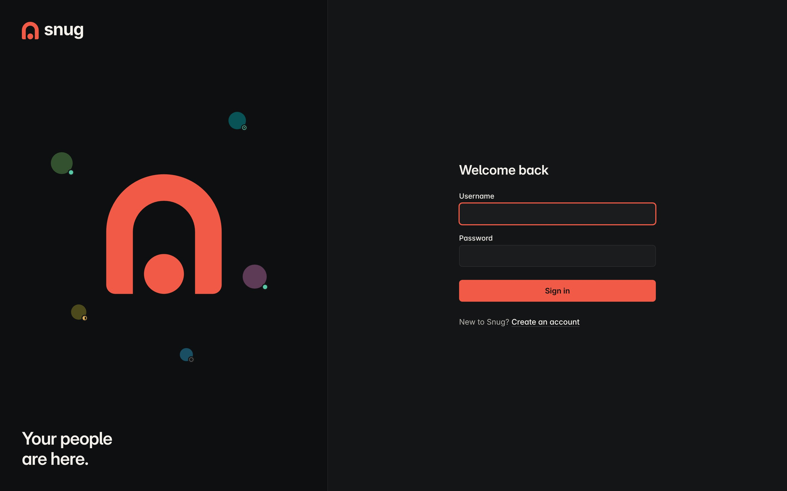

The sign-in page is the one place the brand speaks at full volume: the lockup, a large Nook with a few people in their own hues around it, and one line, "Your people are here." The form is small and plain, and errors sit under the field they are about. After this page the brand recedes to a coral bar, a few badges and a dot.

Why it works:

- **It answers the question people open a chat app with.** "Is anyone here?" comes before "what did I miss?".
- **The mark is part of the interface.** The person in the doorway is the same circle as the presence dot on every avatar. When you see the dot, someone is there.
- **Warmth without a mascot.** The tone comes from coral, rounded letterforms and short copy ("3 people talking", not "3 active users"). No character, no confetti, no gradient, so it stays adult.

## 2. Logo

The symbol is the **Nook**: a doorway with a person standing in it.

| Part | Geometry (64-unit grid, from `docs/brand/BRAND.md`) |
|---|---|
| Doorway | 40 wide by 56 tall. Straight sides, a half-circle top (r 20), a foot radius of 4. |
| Person | A circle, r 9, centred at (32, 42): 9 units above the threshold, 11 from each side. |
| Fill | Doorway in Brand Coral. The person is cut out, or filled `#F4F1ED` on the app icon. |

- **Taller than wide (1 : 1.4), with a person inside.** A round-topped rectangle alone reads as a tombstone. The proportion and the figure make it a door.
- **Centred and low.** Centred, it is calm and lands on whole pixels. Slightly less space below than beside makes the person sit rather than float.
- **Cut out, not drawn on.** The person takes the colour of whatever is behind the mark, so the doorway always shows the ground through it: a space you can enter.

**Wordmark:** "snug", lowercase, Inter Bold, tracking -0.03em, outlined to paths. `#F4F1ED` on dark, `#141516` on light in the brand files; inside the app it is `currentColor`, so it takes `--text-1`. Lowercase keeps it friendly; tight tracking keeps it from looking soft. In the lockup the symbol is 1.4 times the cap height, one person's width from the word.

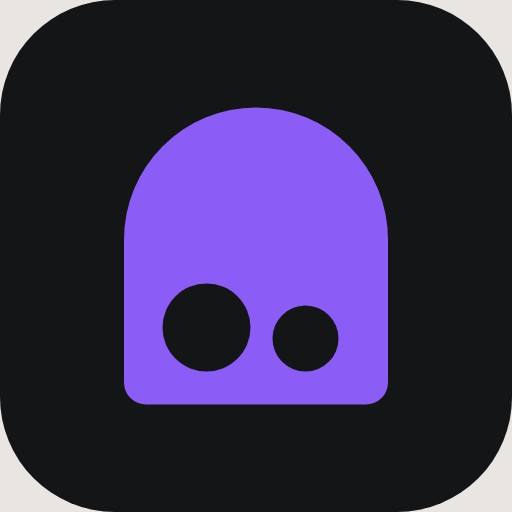

**App icon:** a charcoal `#141516` rounded square (radius 22.5%), the Nook at 60% of the height, the person off-white. A coral square would be loud on a taskbar and turn the brand colour into a background, which the colour rules forbid. On charcoal the doorway is the only bright thing, so it is found quickly.

**Small sizes are redrawn, not scaled.** `brand/favicon.svg` is drawn on the 16px grid (a 10 by 14 doorway, a 4px person on whole pixels). `brand/app-icon-small.svg` does the same for 16 to 32px.

Every edge lands on a pixel, and the cut-out takes the tab colour, so one file works on light and dark browser chrome. Below 16px the rule is to use the presence dot alone.

**Rules:** no stretching, rotating, effects or shadows. The person never moves. The doorway is never mint, amber or red, because those mean status. The wordmark is never coral. The arch is never used for a person or a control, with one deliberate exception: the Home button in the rail is the Nook itself (section 8).

## 3. Color palette

Dark is the base theme (the bare `:root` values). The Theme setting starts on Match device, so a device set to light gets the light theme until the person picks one. Light is a warm paper theme with the same roles. Components use tokens only.

### Surfaces and text

Depth comes from five surface steps on a warm charcoal, not from shadows.

| Token | Dark | Light | Role and reason |
|---|---|---|---|
| `--bg-0` | `#0E0F10` | `#E9E6E1` | Shell and rail. Darkest, furthest back: the building, not the content. |
| `--bg-1` | `#141516` | `#FBFAF8` | Conversation and main content. Where you read. Light is paper, not pure white, to cut glare. |
| `--bg-2` | `#1A1C1D` | `#F3F1ED` | Context column, panes, menus, message hover. One step up: next to the content. |
| `--bg-3` | `#212324` | `#ECE9E4` | Row hover, inputs, skeletons. The step that responds to you. |
| `--bg-4` | `#292B2D` | `#E2DED8` | Selected row, popovers, secondary buttons, selected message. "This one." |
| `--text-1` | `#F4F1ED` | `#1A1817` | Main text. Warm off-white and near-black, so long reading never has a hard edge. |
| `--text-2` | `#B8B4AE` | `#57534E` | Previews, descriptions, row times. |
| `--text-3` | `#8F8C88` | `#6F6A64` | Meta lines, section labels. The dark value was nudged from the contract's `#85827E` to pass 4.5:1 on `--bg-2` and `--bg-3`. |
| `--text-disabled` | `#5C5A57` | `#A39E97` | Disabled controls only. |
| `--line` / `-strong` / `-subtle` | `#292B2D` / `#393B3D` / `#202223` | `#E2DED8` / `#CFCAC3` / `#ECE9E4` | Subtle between frame regions, line under headings, strong for inputs and the thread elbow. |

Why steps instead of shadows: shadows on every panel make dark UI muddy and blur what floats. Here only menus, popovers and dialogs cast a shadow, so a shadow always means "above everything, and it will go away". Why warm neutrals: cool blue-grey reads as a tool. Warm charcoal and paper feel lived in without colouring the content.

### Brand

| Token | Dark | Light | Reason |
|---|---|---|---|
| `--brand` | `#F05A47` | `#E04B38` | Brand Coral. Darker in light to hold contrast on paper. |
| `--brand-hover` | `#FF6B57` | `#EC5A46` | Lighter on hover: the button comes towards you. |
| `--brand-press` | `#DD4E3C` | `#C93F2E` | Darker on press. Dark value nudged from `#D94A39` so dark text still passes 4.5:1. |
| `--brand-soft` | `#3A211E` | `#FBE3DE` | Mention background. Warm without shouting. |
| `--brand-ink` | `#FF7A68` | `#B5402F` | Coral as text, which needs more contrast than a fill. |
| `--on-brand` | `#111211` | `#111211` | Text on coral. White on the light coral is about 4.2:1 and fails; near-black passes. |

**Coral means "for you".** It marks the primary button, the 3px bar beside the place you are in, count badges, the "New" line, the edge of a message that mentions you, and the live moment of voice and events. It is never a large field behind text. Coral is warm, leans orange so it is not the red of errors, and is not the blue or purple of the large chat apps. With one hue for everything that needs you, a glance tells you how much needs you and where.

### Meaning colours

| Token | Dark | Light | Meaning and reason |
|---|---|---|---|
| `--mint` | `#58C7A5` | `#1F8F6E` | Online, connected, speaking, "Going". Blue-green, so it sits beside coral without clashing. |
| `--amber` | `#E8B65A` | `#A86F0D` | Away, warnings, an event starting soon, a weak voice connection. Caution, clearly not an error. The code also uses it for the favourite star on Friends and profiles, a second meaning the contract does not give it. |
| `--cyan` | `#62B8D8` | `#1F7EA3` | Links, information, the "4 replies" link. Quiet enough not to compete with coral. |
| `--rose` | `#D98598` | `#B24E66` | Reactions you added. Warm, clearly yours, soft enough for every message. |
| `--error` | `#E05A5A` | `#C93838` | Destructive actions and failures. Also the Focused dot: "don't interrupt". |
| `--offline` | `#686663` | `#8C8781` | The offline ring. Grey, because offline is an absence. |

Mint, amber, cyan, rose and error each have a `-soft` tint for backgrounds (in light, a 12% mix into `--bg-1`); offline has none. Light adds `-ink` values for mint and amber text (`#156E54`, `#8C5C08`) and a darker link (`#1C7397`), because the fill values are too light to read as text on paper.

### Colours people choose

People, roles and houses choose a **hue only**: Olive, Green, Teal, Sky, Blue, Plum, Clay rose or Pink (`HUES` in `js/lib/util.js`). The theme sets lightness and chroma in OKLCH (names 0.80/0.10 in dark, 0.47/0.12 in light). If people picked full colours, someone would pick red and read as an error, or pale yellow and vanish on paper. Fixed lightness keeps every name readable in both themes, and keeping the list clear of coral, red, amber and mint means a person's colour never reads as a status.

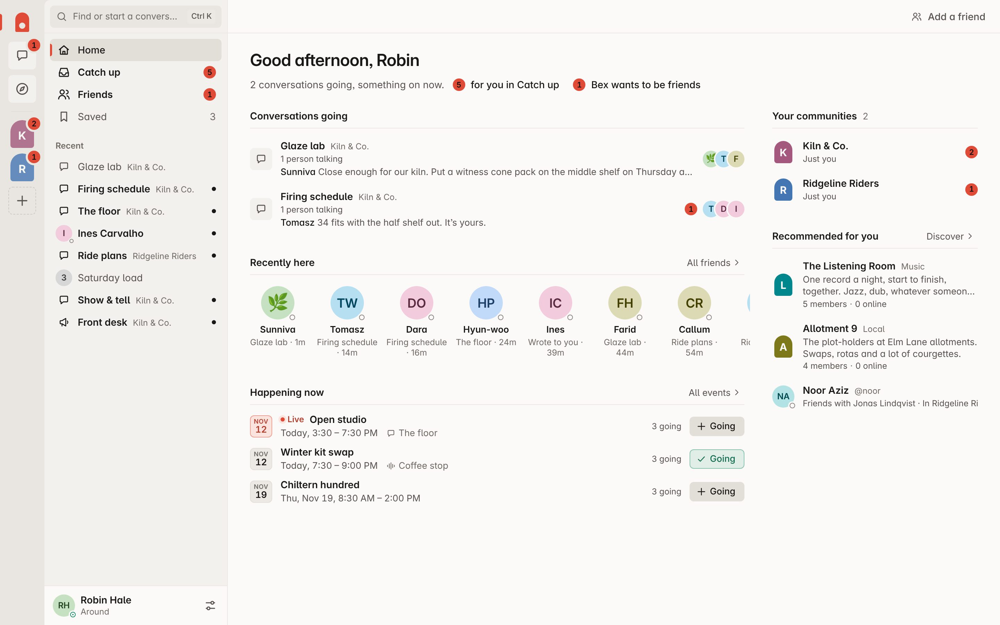

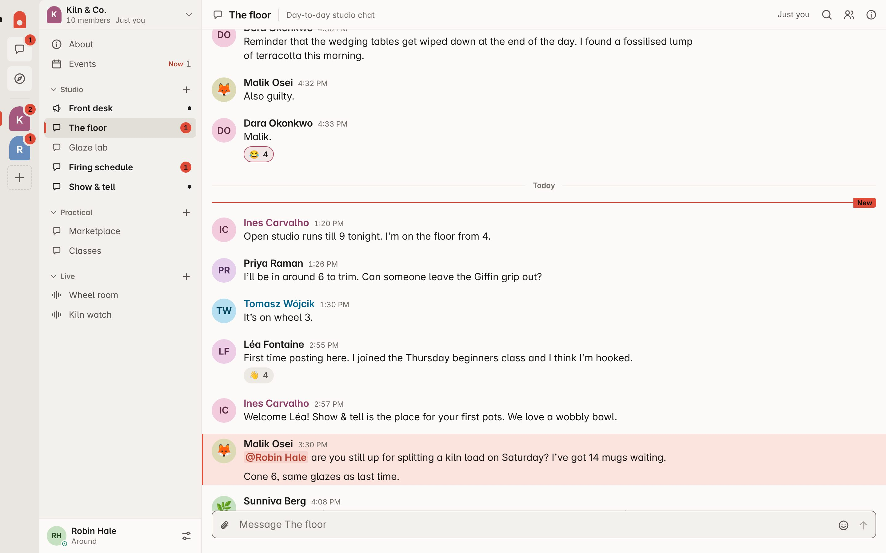

The light theme keeps every relationship: shell darkest, content lightest, avatar grounds flipped to pastel with dark initials (`--tile-l` 0.88), the mention still `--brand-soft` with a 2px coral edge. House tiles do not go pastel: they sit at a mid lightness (`--house-l` 0.56) with light letters, so the arch still reads as a solid door on paper.

**High contrast** (a setting that also follows `prefers-contrast: more`) mixes secondary text and lines toward the main text and thickens the focus ring to 3px, computed from each theme's own values.

## 4. Typography system

**Inter 4 for everything**, vendored as a variable font (weights 100 to 900, optical size 14 to 32). **Atkinson Hyperlegible Mono** for code. One family keeps the page quiet; hierarchy comes from size, weight and colour.

Features on by default:

- `cv11`, a single-storey "a". Rounder, more handwritten: the main source of warmth.
- `cv05`, an "l" with a tail, so "l", "I" and "1" never look alike in names, handles and invite codes.
- `ss03`, round quotes and commas. Softer punctuation in a text-heavy app.
- Not used: `ss01` open digits (they break the tabular rhythm of times) and `cv08` serif I (too bookish).

| Token | Size | Used for |
|---|---|---|
| `--t-32` | 32px | House and profile names on their pages, the Discover stage name, the sign-in line, emoji-only messages |
| `--t-24` | 24px | The Home greeting, the Discover headline, page titles (`h1`); house, profile and stage names on the phone |
| `--t-20` | 20px | Section headings (`h2`), the profile card name, the phone greeting and screen titles |
| `--t-16` | 16px | Message text (Regular, Roomy), body copy |
| `--t-14` | 14px | Message text in Compact, row labels, buttons |
| `--t-13` | 13px | Meta lines, thread stubs, previews |
| `--t-12` | 12px | Section labels, small chips |
| `--t-11` | 11px | Keyboard hints, the "New" label, badges |

Sizes are in rem, so the Text size setting scales them. Weights: 400 reading, 500 names, 600 emphasis, 700 rarely (the wordmark, tile letters). Line heights: 1.15 display, 1.25 headings, 1.45 body, 1.3 compact UI.

**Messages are 16px**, capped at 46rem (about 80 characters). Most chat apps use 14 or 15px, which suits skimming and tires reading. Snug is for conversations people read; Compact drops to 14px for those who want more on screen. The cap stops a line from running the width of a wide window, where the eye loses the next line.

**Code** uses Atkinson Hyperlegible Mono for the same reason as `cv05`: its 0, O, 1 and l are designed to differ. Tomasz's cone temperatures in the Glaze lab screenshot show it.

## 5. Iconography

One family in `js/ui/icons.js`: line icons on a 20-unit grid, a 1.5-unit stroke, rounded caps and joins. The default size is 20px, where the stroke is exactly 1.5px. The tokens name 12, 16, 20, 24 and 32px, but the views also pass 14, 18, 22 and 28px (16 is the most used, then 14 and 18), so the size scale is not enforced.

The set covers what the app does and no more (49 glyphs, from search and reply to mic, compass and calendar). A 1.5px line sits at the same weight as Inter at 14 to 16px, so an icon and its label read as one unit. Filled forms are kept for state: `saved` and `starred` fill when on, so "on" is visible without colour. Each room kind has its icon (a bubble for text, sound bars for voice, a megaphone for notices), first in its row, so the kind is known before the name is read.

Some marks are deliberately not icons: topics use a plain "#", presence uses CSS shapes, communities use arch tiles. The camera and screen icons the contract asked for arrived with video in voice rooms (`camera`, `camera-off`, `screen`, `screen-off`, plus `expand` and `shrink` for focusing a tile), and voice messages and GIFs brought `play`, `pause` and `gif`.

## 6. Shape language

**Places are arches, people are circles, controls are rectangles.**

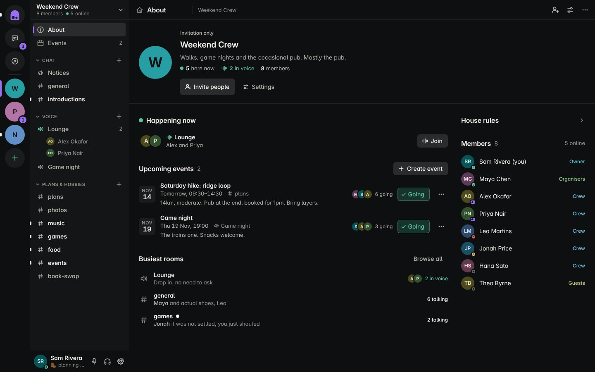

- **Places are arches.** Community tiles use `--r-arch` on a portrait box 0.84 times as wide as tall, so the top closes into a full round and reads as a doorway even at 28px. A community is a door you can walk through, the same shape as the logo. Even the smallest house marks (the shared-house tiles in friend rows, the tiles in Settings) stay arches; there is no smaller fallback shape.
- **People are circles.** Avatars, presence and the person in the Nook. The only other circles are badges and dots, which are about people too.
- **Controls are rectangles.** Buttons and inputs 6px, menus 8px, dialogs and the few cards 12px, large media 16px. Chips are the one rounded control.

In a chat app you scan for where, who, and what can I do. A distinct silhouette for each lets a row be parsed before it is read. On the house page above, the arch says place, the circles say people, and the buttons are plainly buttons. Rounded squares for everything, the common choice, lose that signal.

**Presence is shape first, colour second**, attached to the avatar's edge, never over the face:

| State | Mark | Meaning |
|---|---|---|
| Open to talk | Filled mint dot | Happy to be called or pulled into a room |
| Around | Mint ring with a centre dot | Here and reading. Write any time |
| Focused | Red dot with a bar | Heads down. Notifications wait in Catch up |
| Away | Amber half dot | Not at the screen |
| Offline | Grey ring | Not here, or appearing offline |
| In a voice room | Coral rounded rectangle with sound bars | Wins over the rest: the most useful thing to know |

About one man in twelve has a colour vision deficiency, and green against amber is a pair that blurs. A dot, a ring, a bar and a half dot differ in greyscale. The voice mark is a rectangle because it is the one state that is also an action: join them.

**Cards only for separate objects:** attachments, events you can act on, community previews, floating layers. People, rooms and conversations are rows with a hover state. This is why Home and Catch up look like lists, not dashboards.

## 7. Layout system

**Desktop has three levels, always visible: rail, context column, content. A side pane opens only when asked for.**

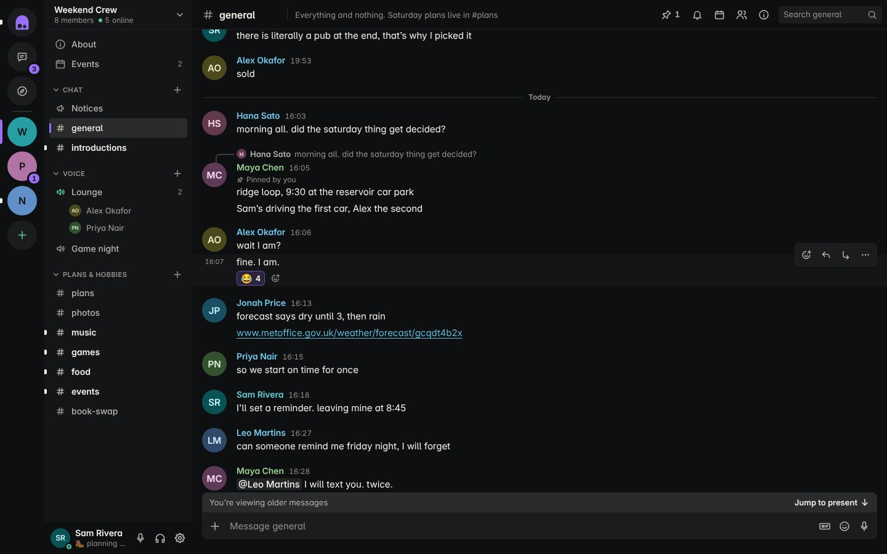

| Region | Width | Surface | Holds |
|---|---|---|---|
| Rail | 64px | `--bg-0` | Home, Messages, Discover, your communities, Create or join |
| Context column | 264px | `--bg-2` | What is in the chosen place; your panel pinned at the bottom |
| Content | Fluid | `--bg-1` | The view |
| Pane | 384px | `--bg-2` | A thread, people, or room details |

Fixed regions that never reorder let people build a spatial memory and reach for a place without reading. **Below 1180px** the pane lies over the conversation instead of squeezing it, because a squeezed conversation wraps every message into a tall column. **Below 760px** the phone product takes over (section 20).

**Space** is a 4px base: 4, 8, 12, 16, 20, 24, 32, 40, 48, 64, 80, with exceptions for 1px borders, 2px hairlines, the 6px message padding and the 10px gap between message groups in Regular density (`--group-gap`, which the token comment does not list). With eleven values, related things are visibly closer than unrelated ones, and grouping reads without boxes.

**One left margin runs through the conversation.** Avatars, reply elbows and thread branches hang from the same column, so in the screenshot the root message, the "4 replies" stub and the elbow line visibly branch.

**Density** is three token sets: Compact (32px avatars, 14px text, 1.35 line height), Regular (40px, 16px, 1.45) and Roomy (40px, 16px, 1.55, wider gaps). Compact also shrinks avatars and text; Roomy changes only line height and spacing. Main pages (Home, Discover, profiles) cap at 72rem with a main column for what is happening and a side column for context.

## 8. Navigation architecture

The place you are in is `S.ui.space`: `home`, `messages`, `discover` or a house id. It follows the view (a room puts you in its house, a direct message in Messages) and is remembered per device with the last view in each place.

**The rail.** Home is the Nook itself, in coral: the logo is the way home. Messages and Discover are rectangles on a quiet step, because they are controls. Communities are arch tiles in your order. Create or join is a dashed "+". The left edge says what each item is to you: a 3px coral bar where you are, a short light pill (the same bar at a third of its height) where something is new, and a coral count on the tile when something needs you. A bar rather than a filled tile keeps coral fills for counts.

**The context column**, per place:

- **Home:** Home, Catch up, Friends, Saved, then Recent conversations across every place. Recent rows use a plain dot, not a second count, because Catch up already carries the total.
- **Messages:** direct messages and groups, new message, search.
- **Discover:** For you, Communities, People, Events, then ten topics.
- **A house:** the header (tile, name, member and online counts, menu), About, Events with a "Now" tag when something is live, then rooms by group. Followed threads with news appear as sub-rows under their room. Voice rooms show who is inside.

**Your panel** sits at the bottom of every column: face with presence, name, status, settings. In a voice room, a voice dock appears above it and follows you everywhere.

**Movement.** Choosing the place you are in goes to its front page; choosing another reopens where you were. `Ctrl/Cmd K` jumps anywhere. `Alt Up/Down` moves through the column, `Alt Shift Down` goes to the next place with news, `Alt Left` goes back. Back (button or gesture) closes the top layer, one at a time, instead of leaving the app.

Splitting "which place" (rail) from "what is in it" (column) keeps both lists short, where one long sidebar would mix your places with the app's global views.

## 9. Home

Home answers: who is around, where are people talking, what is about to happen, and does anything need me.

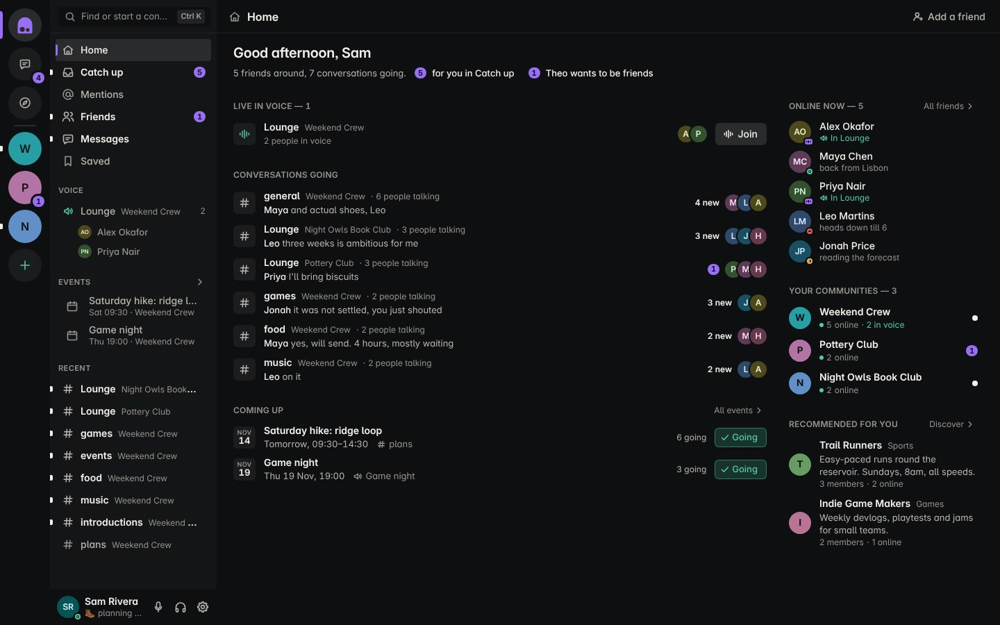

The greeting ("Good afternoon, Robin") is followed by a summary from real state ("2 conversations going, something on now.") and two chips with coral counts: "6 for you in Catch up" and "Bex wants to be friends". Each goes straight to the place that deals with it.

The main column, each section only if it has something:

1. **Friends online**, each face saying what they are doing.
2. **Live in voice**: voice rooms with people in them.
3. **Conversations going**: where someone wrote in the last 15 minutes or is typing. Voice rooms with people in them are left out here, because Live in voice already shows them. Each row shows how many are talking, the latest line, a count if something needs you, and faces. Ordered by liveness (voice 3, talking 2, typing 1).
4. **Recently here**, when no friend is online: up to eight people who wrote in the last hour, and where. The place reads as lived-in at quiet times without inventing activity.
5. **Happening now** or **Coming up**: up to three events, with a Going button that turns mint when you are.

With nothing on: "It's quiet right now." The side column has Your communities (online count or "Just you") and Recommended for you (three communities, or two and one person you might know), fetched at most once every five minutes.

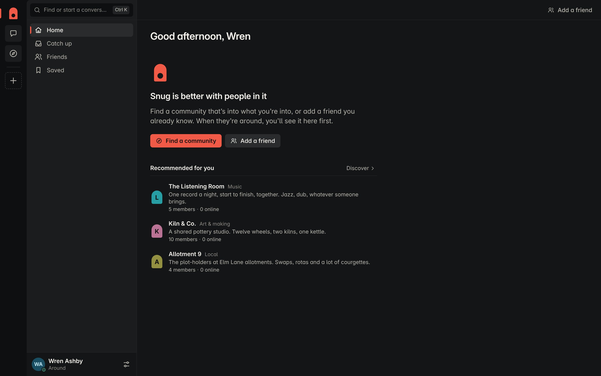

A new account sees one warm sentence, Find a community and Add a friend, and three recommended communities. No tour, no checklist.

Why it works: it leads with people and liveness, and keeps counts to two chips. Everything comes from state (`activeConversations`, `liveVoice`, `upcomingEvents` in `js/lib/social.js`), so it can be trusted at a glance. And it ends: at most six conversations and three events. A feed would reward scrolling; Home lets you finish.

## 10. Friends

Tabs: Online, All, Requests and Add friend.

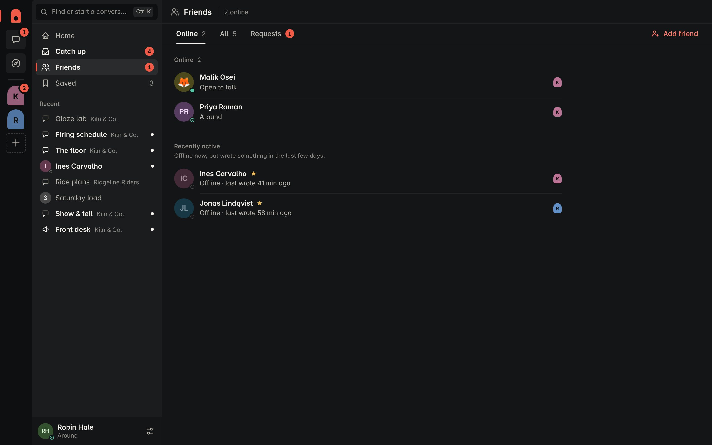

**Online** lists friends who are here: online favourites first under their own "Favourites" heading, then the rest ("Also online") by the most reachable (Open to talk before Around before Focused), then by name. Each row shows the face, name, what they are doing ("Open to talk", a status, "In Wheel room"), and the communities you share as small arches. On hover or focus the arches step aside for actions. Below, **Recently active** shows up to five offline friends who wrote in the last few days ("last wrote 41 min ago"). Favourites carry a star, drawn in amber. Add friend is the fourth tab, set apart at the right in coral ink.

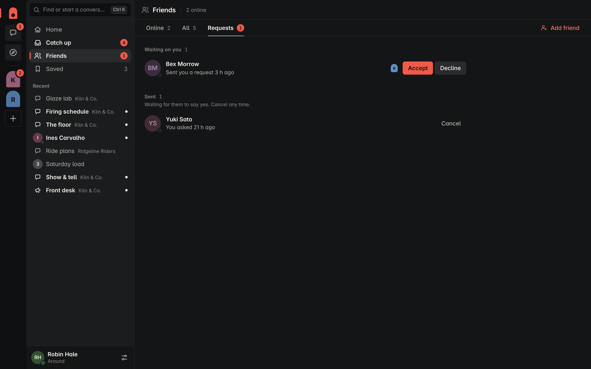

**Requests** has "Waiting on you" (Accept, Decline) and "Sent" (Cancel).

The rules, in `server/ops.js`:

- Request by username or from a profile. Asking someone who already asked you counts as yes.
- Declining starts a 24-hour wait before they can ask again. Cancelling your own request starts the same wait, so cancel-and-resend cannot nag.
- At most 50 waiting requests, and a rate limit.
- Favourites are private, and only friends can be starred.
- Friends see each other's presence without sharing a house. A pending request shows your presence to the person you asked, not theirs to you.

Friends are the reason to open Snug when no community is busy. Showing what each is doing, and what you share, gives a reason to write. The list is one tab stop; arrows move, Enter opens a profile.

## 11. Direct messages

Direct messages and groups live under Messages. You can write to friends and to anyone you share a house or conversation with. A pending request is not enough. A group holds you and one to nine others.

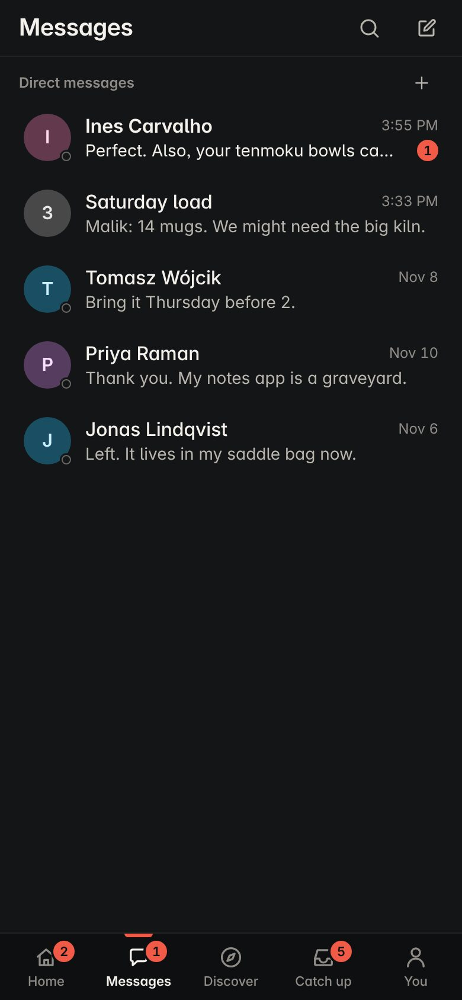

Each row shows the face with presence (a count for a group, such as "3" for Saturday load), the name, the time and the last line. A conversation with something new shows a coral count, because a direct message is always for you. On the phone, rows grow to two lines with a 40px face and its full presence mark. The face keeps the single initial of the small row icon even at 40px, where two would fit.

A direct message is the same component as a room: stream, composer, threads, reactions, replies, saved messages, search. One model means one set of habits.

**Notification levels.** A one-to-one conversation offers only Everything or Nothing, because it is always addressed to you. A group can also choose "Only what needs me" (mentions and replies), so a busy group does not demand you like a person writing to you does.

## 12. Community discovery

Discover is editorial, not a feed: four sections (For you, Communities, People, Events) and ten fixed topics.

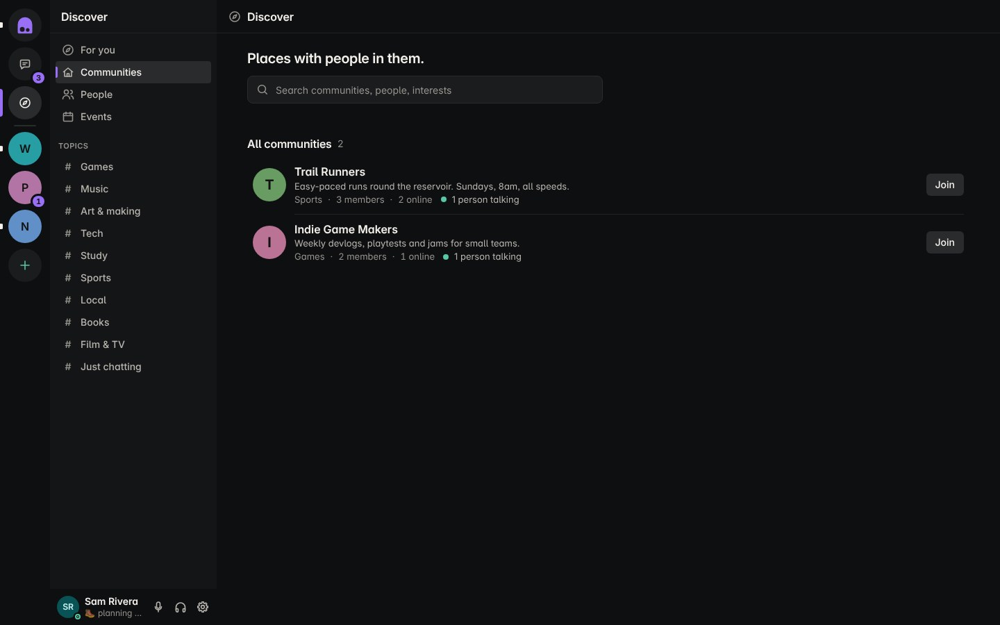

**For you** puts one community on a stage: a large arch, a kicker ("Lively right now", or "Worth a look" when quiet), name, topic, size, description, "3 people talking", who you know there ("Ines and Mira are here"), and Join and Take a look. Below: Happening now, New communities, People you might know. Despite its name, Happening now lists events on now, then live communities, then later events from the liveliest few houses, which is why the screenshot shows a Saturday listening party under it.

**The stage is earned.** The server ranks public communities you are not in by people in voice, then talking, then online, then size. Nothing is paid for or promoted.

**People you might know** says under its heading: "People you share a house or a friend with. Nobody else shows up here." Each row gives the reason ("Friends with Jonas Lindqvist · In Ridgeline Riders"), and the server returns nobody else. Saying where a suggestion comes from turns it into a reminder instead of something that feels like surveillance.

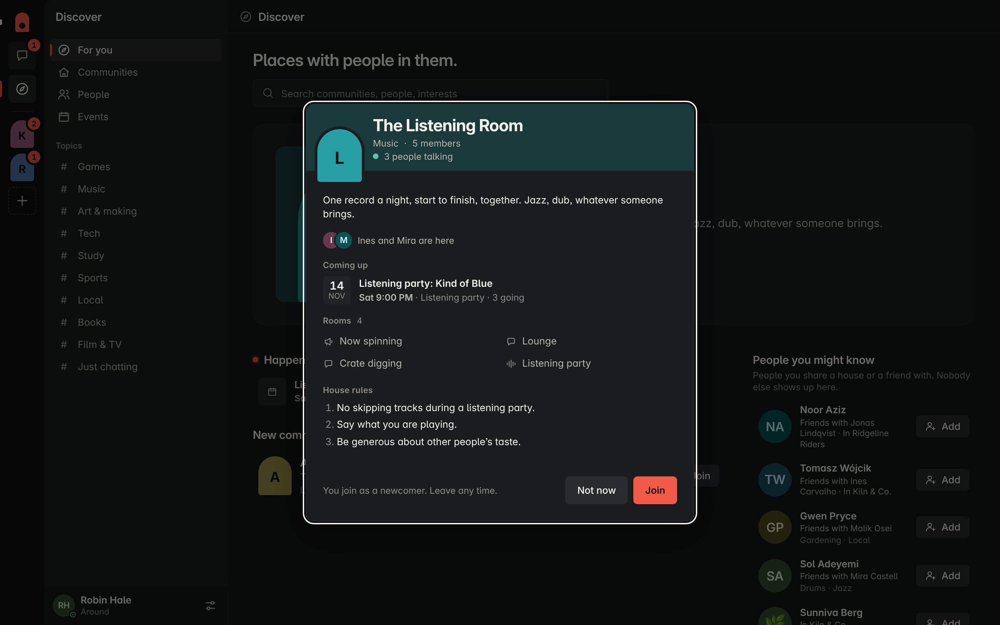

**Every community opens a preview before you join**: description, which of your friends are in it (never the full member list), up to three coming events, the rooms, the house rules, and "You join as a newcomer", with Not now and Join. Joining blind and landing in a wall of channels is the most common bad first minute in community apps. The rules come before the Join button.

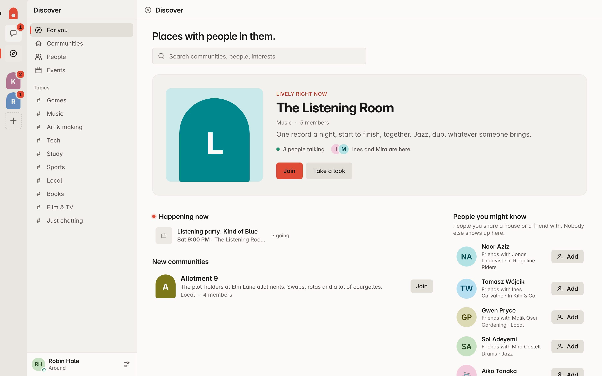

Discover lists only public houses, as counts and room names, never member lists. For you shows one stage, up to five live items, six new communities and five people, then stops. Topics and search serve intent; For you is for a glance.

## 13. Community screen

A community (a **house**) has a front page: About in its column, or its tile chosen again. See the Kiln & Co. screenshot in section 6.

- **Header:** arch tile, name, "Art & making · Open to everyone", description, "1 here now · 10 members", and Invite people and Settings for those allowed. No banner and no colour wash: the arch carries the colour and a 1px line ends the header. A banner needs artwork most small communities do not have.
- **Happening now:** live voice and events on now, with a coral pulse. Live voice is a row, not a card.
- **Upcoming events**, with Create event for those allowed.
- **Busiest rooms** on desktop, because the column already lists every room. The phone shows the full list.
- **Side column:** House rules, and Members with role names in role colours ("Studio lead", "Technician"). The rules are a numbered list that starts open for newcomers and folded to "House rules 4" for everyone else, as in the screenshot.

"Here" never counts you. At zero it says "Just you", with no green dot. A count of one that turns out to be yourself teaches people to ignore the number.

**From the doorstep**, a house you are not in shows the same page with a way in, from an invitation or a public preview.

**Newcomers** can read history, but none of it counts as unread. They see only the starter rooms the house picks in Settings, Newcomers (the page suggests three; the server allows up to twelve), and a welcome with one first step; the other rooms open after their first message. The first step can only come from seed data today: there is no setting for it, so a new house gets "Say hello" in its second starter room. Fifteen rooms and hundreds of unread messages make people leave; three rooms and one thing to do is a way in.

**Roles** are checked on the server, and the same rules file (`js/lib/perms.js`) decides what the browser shows. Permissions: send messages, post notices, curate highlights, remove messages, manage rooms, invite people, manage roles and members.

**Events** are planned by members who may post notices or manage rooms; any member can say they are going, and the planner is going. No end time means two hours. States: Live (coral), Soon (within the hour, amber), later.

## 14. Text channels

A room is one continuous stream, dense where people read.

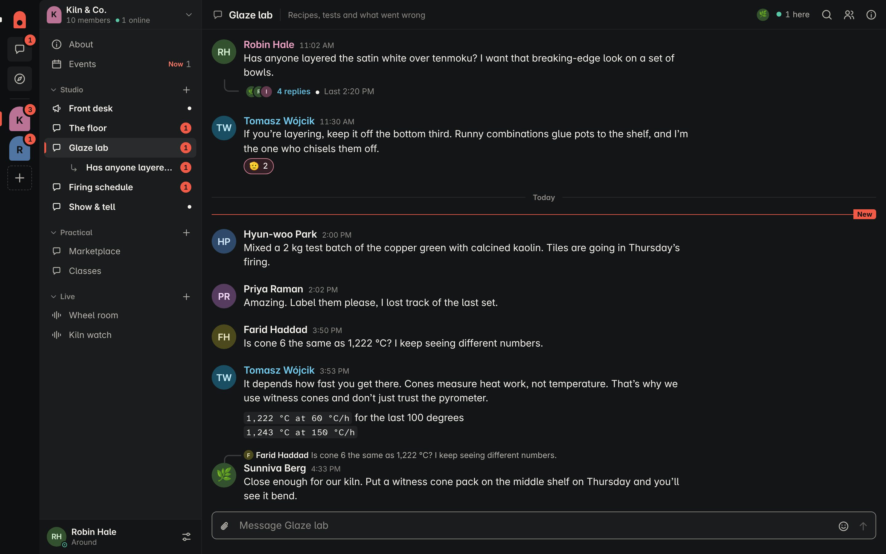

**The header:** room icon and name, topic, who is here ("1 here", never counting you, or "Just you"), "2 in voice" in a voice room, and search, people and details.

**Messages** are rows: avatar, name in the person's colour, time, text. Consecutive messages from one person group under one name. Hover lifts a row one step. A message that mentions you or replies to you gets `--brand-soft` with a 2px coral edge; a mention of someone else is a quiet grey chip. The same rule (`forMe` in `attention.js`) decides what is counted and what is highlighted, so they always agree.

**The "New" line** is a coral rule with a small "New" label at its end. Arriving in a room goes to where you left off this session, else to the first unread with context above it, else to the latest.

**Replies** show an elbow from the margin to a quoted line. **Threads** show a stub with the repliers' faces, "4 replies" in cyan and the last time, branching from the message. A thread opens in the side pane beside its conversation (section 7) with its own "New" line and composer. Followed threads with news appear under their room in the sidebar, and replies in them count as needing you. A thread that replaces the conversation loses context; one in a popover cannot be read. A pane keeps both.

**Reactions** are chips; yours are rose. **Formatting** is bold, italic, strikethrough, inline code, fenced code blocks, links and @mentions, turned into a token tree and then elements, never HTML. A message of one to three emoji and nothing else is shown large.

**Actions:** a hover toolbar at the top right (react, reply, thread, save, more). The full menu has the same order everywhere: reply, thread, save, copy text, mark unread from here, add to room highlights (if allowed), edit (yours), delete (yours, or anyone's for moderators, with undo).

**The composer** grows with the text: attach, text, emoji, send. Files upload as soon as they are attached, so Send is instant. Photos are scaled to 1600px and re-encoded, which strips location data; GIFs keep their animation. Typing shows three breathing dots and who.

**Sending is optimistic.** A message appears at once with its own id. Offline, it waits and sends on reconnect, and the id means a retry can never post twice.

**Keyboard:** `Shift Tab` from an empty composer enters the messages; arrows move; `R`, `T`, `S`, `E` reply, thread, save, edit. `Esc` marks the room read; `Shift Esc` marks the house read.

## 15. Voice channels

Voice rooms are rooms with a stage above their text history. Audio is real WebRTC, directly between people; the server only introduces them.

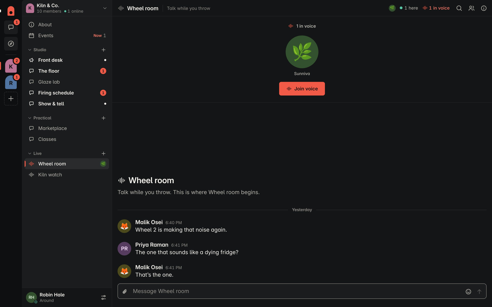

**Before you join** you see who is in: faces on the stage, "1 in voice", Join voice. The sidebar row shows the same faces, with a join button on hover. Whether to join depends on who is there, so Snug shows it before you commit.

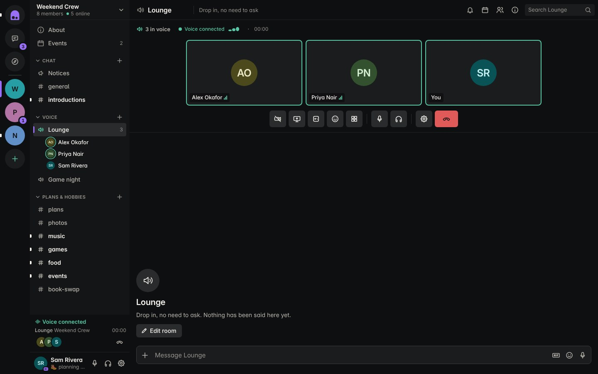

**In the room:**

- "2 in voice · Connected" (or "Waiting for your microphone…", "Joining…").
- Faces are large in a small room and shrink as it fills, so everyone fits.
- **Speaking** is detected from the real audio level with a short hold. A mint ring appears at once and fades over 160ms. Mint, because speaking means connected and active.
- Three bars beside each other person's name show their connection quality once you are in (amber when weak). Your own face has none.
- Mute, deafen and leave sit under the stage. Leave has red ink and fills only when you reach for it.
- Your presence becomes the coral voice mark, the header says "2 in voice", and the voice dock follows you anywhere.

The text history stays below, because people in voice paste links and notes and should not need a second channel.

Audio is a full mesh, capped at 12. Echo cancellation and noise suppression are on. Microphone errors are plain ("Another app is using your microphone. Close it and try again."). One flaw shows in the screenshot: the stage keeps its height, leaving an empty band above the text history. A stage that shrinks to its content would give that space back.

## 16. User profiles

A profile is a person's corner, reached in two steps: a card for a quick look, a page for the whole picture.

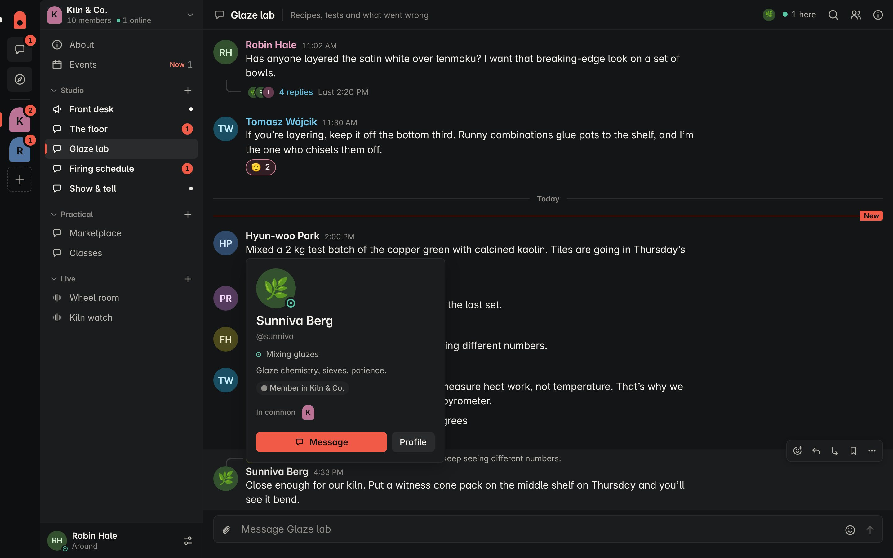

**The card** opens from any name or face without leaving the conversation: avatar with presence, handle, status ("Mixing glazes"), bio, role in this house, communities in common, and Message and Profile. Most of the time you want to know who someone is and keep reading.

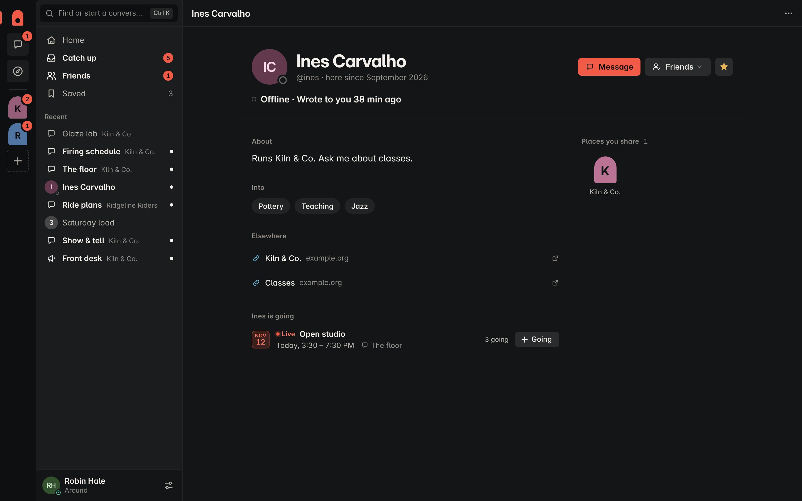

**The page** puts a large face beside the name, then a line about now ("Offline · Wrote to you 38 min ago"), "here since September 2026", and Message, the friend button and a star. Below: About, up to 8 interests as chips, up to 3 links (https only, checked on the server), events they are going to, and Places you share as arches.

**No banner.** The contract asked for one; the fix pass removed it. A banner needs an image most people never upload, and an empty colour block takes the top third of the page. A line about what the person is doing now is more useful.

**Avatars** are initials on a hue, or one emoji. Below 28px two letters stop being readable, so small circles show one. Photo avatars are not built.

**Who sees what:** presence and status reach people who share a house or conversation with you, your friends, and anyone you have asked to be friends. Everyone else sees you offline with no status.

## 17. Notifications (Catch up)

**Catch up instead of badges everywhere.** One view answers "what needs me?" first, then summarises each room.

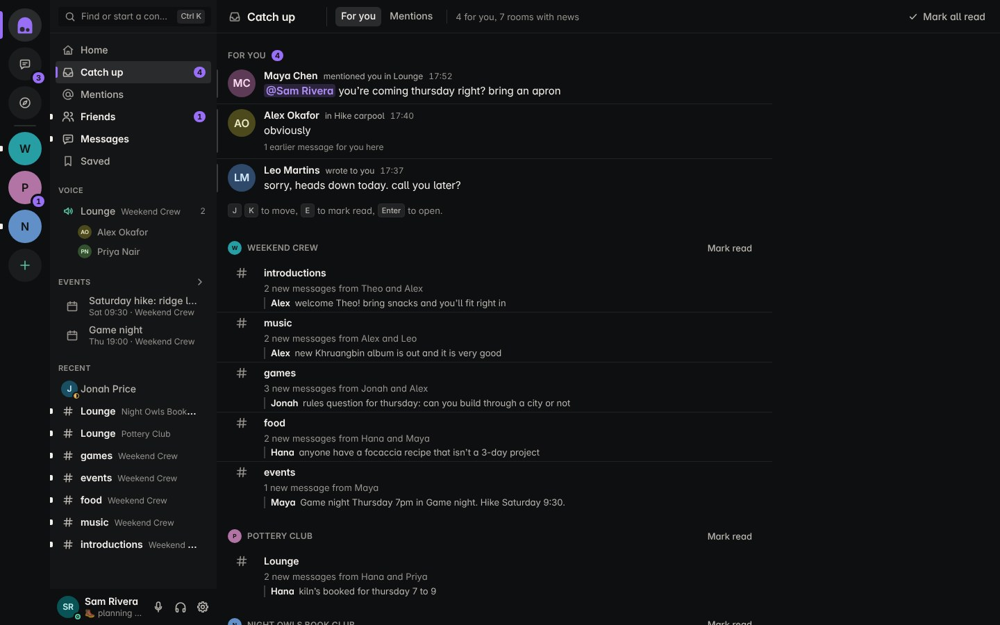

**For you** has one item per conversation: invitations (with Take a look and Not now), direct messages, mentions, replies to you, replies in followed threads. Each shows the latest message and how many more, so a lively group is one line to deal with, not twelve. **Room news** follows, per house: how many messages, from whom, and the one people reacted to most.

**It is a triage list:** `J`/`K` move, `E` marks read, `Enter` opens; on a phone, swipe left. Marking read can be undone.

**The whole policy is one file**, `js/lib/attention.js`:

- `forMe`: does this message mention me or reply to me?
- `needsMe`: is it a direct message, for me, or a reply in a thread I follow?
- `attention`: should the navigation show a dot or a number?

**Two levels of unread.** What needs you gets a coral count. Everything else is a dot, never a number. A number on every channel trains people to ignore numbers; when only personal things are counted, the count means something and can reach zero.

**One setting per place:** Everything, Only what needs me, or Nothing. Rooms inherit from their house.

**Interruptions** are pop-ups inside the app and desktop notifications from a background tab, both only for what needs you. **Focused** holds them all; everything waits in Catch up.

## 18. Search

Search covers every stored message you may read, on the server. Offline, it covers what is on the device.

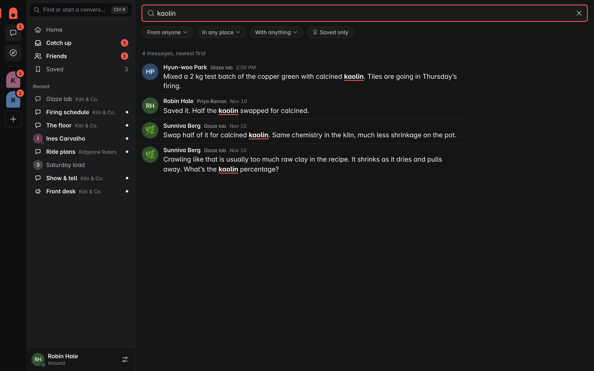

**The query reads like a sentence:** `from:sunniva in:"glaze lab" has:image`. The chips (From, In, With, Saved only) write those words for you, so people learn the syntax by watching. Examples use a real person and room of yours, so they work when clicked.

**Results** say how many and in what order ("4 messages, newest first"; at most the first 80, and offline it says it only covers this device), keep the conversation's left margin, carry an author and place label, and show the match in bold with a 2px coral underline. A yellow highlighter would add a colour that means nothing else in the system.

**Quick jump** (`Ctrl/Cmd K`) is one field for going somewhere or finding something. **Saved messages** sit under Home, each with an optional note, synced across devices.

## 19. Settings

Settings is a full layer with its own sidebar, so it never crowds the chat.

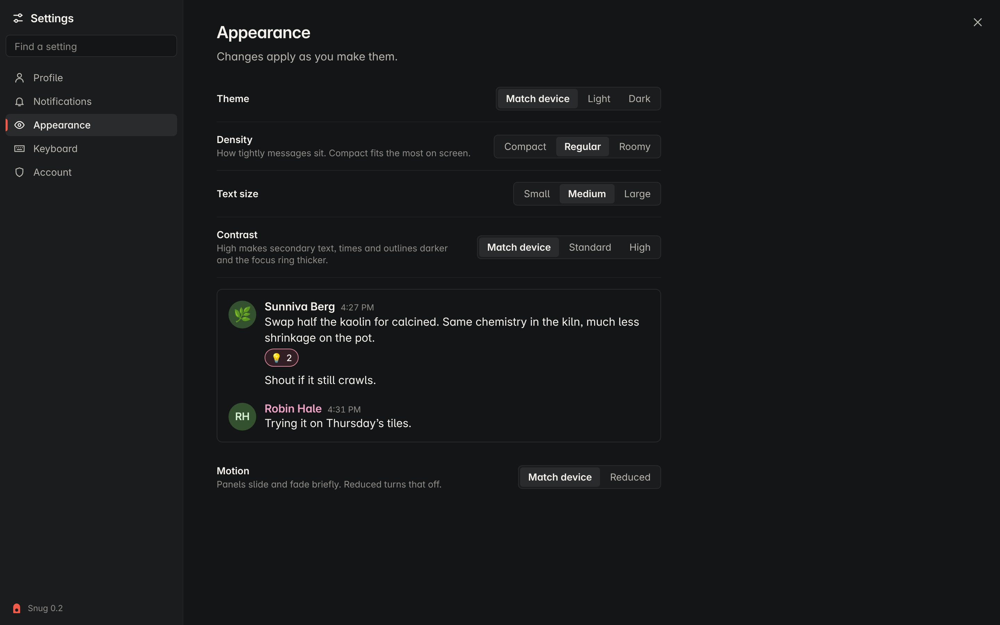

**Pages:** Profile, Notifications, Appearance, Keyboard, Account. "Find a setting" filters by everyday words ("dark", "password"). A house has its own layer: Overview, Roles, Members, Newcomers.

**Every change applies at once; nothing to save.** A Save button creates a state where the screen shows one thing and the app does another. The live preview on Appearance (real messages, drawn by the app's own Message component) shows the effect before you leave.

- **Appearance:** Theme (Match device, Light, Dark), Density, Text size, Contrast (Match device, Standard, High), Motion (Match device, Reduced).
- **Notifications:** Pop-ups, Desktop notifications, a note on Focused, and one three-way control per house with room overrides listed.
- **Account:** connection state, password change, sign out here, sign out everywhere.

**Bug:** the sidebar footer reads "Snug 0.2" (visible above). The app is 0.3.0. The label is hard-coded at `js/views/settings.js:314`.

## 20. Mobile navigation

The phone is its own product, not a squeezed desktop. It takes over below 760px.

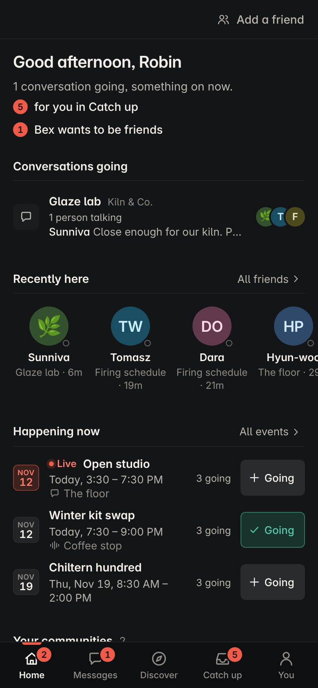

**Five tabs where thumbs are:** Home, Messages, Discover, Catch up, You. Badges: Home counts invitations and friend requests, Messages counts direct messages that need you, Catch up counts everything that needs you. A rail of community tiles would eat a quarter of a 390px screen, so communities are reached from Home and Discover.

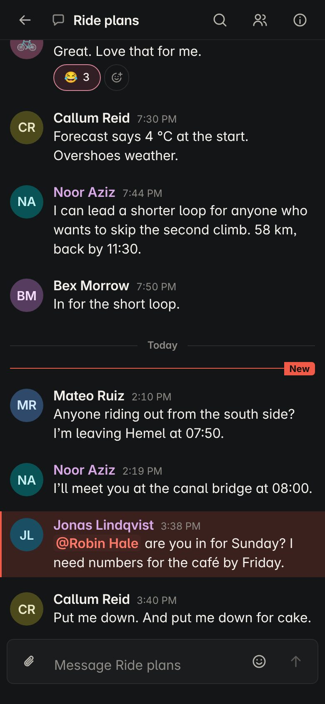

**One screen at a time**, pushed from the right over 240ms. The back arrow and the system gesture both go back one layer.

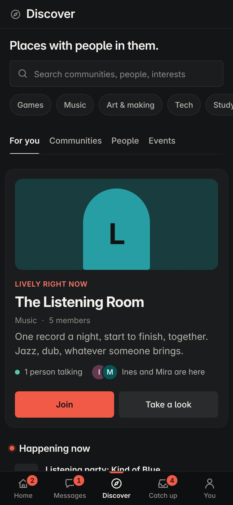

Discover's topics become scrolling chips and its sections become tabs.

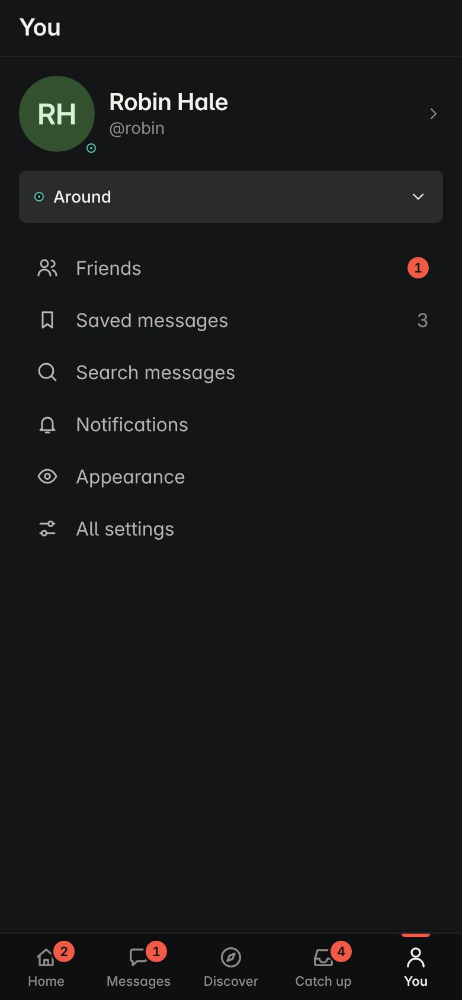

**You** holds what the desktop keeps in your panel: your card, a presence picker, Friends, Saved messages, Search, Notifications, Appearance and All settings.

**Touch rules:** 44px targets for rows, buttons and menu items. Menus and dialogs are bottom sheets. Long-press (450ms) opens message actions. Swipe left marks a Catch up item read. House pages list every room, since there is no column.

## 21. Design system

All values live in `css/tokens.css`.

**Spacing:** `--s-1` 4, `--s-2` 8, `--s-3` 12, `--s-4` 16, `--s-5` 20, `--s-6` 24, `--s-8` 32, `--s-10` 40, `--s-12` 48, `--s-16` 64, `--s-20` 80px.

**Radius**

| Token | Value | Used for |
|---|---|---|
| `--r-xs` | 4px | Tiny marks, keyboard keys, the arch foot |
| `--r-sm` | 6px | Buttons, inputs, rows |
| `--r-md` | 8px | Menus, tooltips, attachments |
| `--r-lg` | 12px | Dialogs, the few cards |
| `--r-xl` | 16px | Large media |
| `--r-full` | 9999px | People, badges, presence, chips |
| `--r-arch` | `50% 50% 4px 4px / 42% 42% 4px 4px` | Houses |

**Type:** 32, 24, 20, 16, 14, 13, 12, 11px in rem; `--t-msg` 16px (14 in Compact); weights 400, 500, 600, 700; line heights 1.15, 1.25, 1.45, 1.3.

**Heights:** `--h-sm` 32px (nav rows, small buttons), `--h-md` 40px (buttons, inputs), `--h-lg` 48px (large buttons, attachments, the top bar), `--touch` 44px (every target on coarse pointers). **Frame:** rail 64, column 264, pane 384, bar 48px.

**Icons:** tokens 12, 16, 20 (default), 24, 32px; views also use 14, 18, 22 and 28px. **Avatars:** 24, 32, 40 (default), 48, 64, 96px. Presence 8px (6px on 24px avatars), attached, never over the face.

**Shadows** (floating layers only)

| Token | Dark | Light |
|---|---|---|
| `--shadow-sm` | `0 2px 8px rgba(0,0,0,.18)` | `0 2px 8px rgba(26,24,23,.08)` |
| `--shadow-md` | `0 8px 24px rgba(0,0,0,.24)` | `0 8px 24px rgba(26,24,23,.12)` |
| `--shadow-lg` | `0 16px 48px rgba(0,0,0,.32)` | `0 16px 48px rgba(26,24,23,.18)` |

Light shadows use the warm text colour, so they do not look grey on paper.

**Motion**

| Token | Value | Used for |
|---|---|---|
| `--m-fast` | 100ms | Hover, press |
| `--m-standard` | 160ms | Menus and popovers entering, the speaking ring |
| `--m-smooth` | 240ms | Dialogs, sheets, panes, pushed screens |
| `--m-slow` | 320ms | Reserved (unused) |
| `--ease-out` | `cubic-bezier(0.2, 0.8, 0.2, 1)` | Entering |
| `--ease-in-out` | `cubic-bezier(0.45, 0, 0.25, 1)` | State changes |

All token durations become 0ms under reduced motion. Three loops have hard-coded lengths outside the tokens: the loader's 1.2s cycle (its 240ms move is 20% of it), the 1.6s live pulse and the 1.6s flash on a message you jump to. The loader and the pulse are switched off separately under reduced motion.

**States**

| State | Treatment |
|---|---|
| Hover | Text colour at 5% (`--hover`), or one surface step up for rows |
| Pressed | Text colour at 9%; coral to `--brand-press`, secondary to `#3B3D3F` (`#D0CBC4` in light) |
| Focus | 2px `--text-1` outline, offset 2px (3px in high contrast). Text fields are the exception: a focused field gets a coral border plus a 1px coral ring instead (visible on the sign-in and search screenshots) |
| Selected | `--bg-4`, plus the 3px coral bar for the current place |
| Unread | Bold label and a small `--text-1` dot |
| Needs you | Coral count badge, `#111211` text |
| Disabled | `--text-disabled`, no hover |
| Loading | Skeletons on `--bg-3` in the shape of what is coming (static under reduced motion); the Nook loader for the app |
| Error | `--error` text under its field; a plain toast when the server refuses |
| Success | A toast with Undo; mint for "Going" and "Connected" |
| Empty | One sentence, one way forward |
| Offline | Messages wait and send on reconnect; search uses what is on the device |

## 22. Interaction principles

1. **Act at once, allow undo.** Messages appear before the server confirms; settings apply on change; delete and mark read offer Undo instead of a confirmation. Confirmations teach people to click Yes without reading.
2. **Dialogs only for decisions that block everything else**, one question and one main button each. Leaving a house is a dialog; marking a room read is not.
3. **Nothing reorders under the pointer.** The rail and column keep their order. Liveness ordering is for Home and Discover, which you read rather than click by position.
4. **Back means one layer**, for the button, the gesture and `Esc`.
5. **The keyboard reaches everything.** `?` lists every shortcut. Lists use roving focus. Message actions have single-letter keys shown in tooltips.
6. **Look before a social commitment.** Communities preview their rules; voice shows who is in.
7. **Say what happened, in words.** "That event is over." "Your role can't plan events in this house."
8. **Never lose what someone wrote.** Offline messages wait, retries cannot post twice, drafts are kept per conversation on the device.
9. **Same thing, same place.** Message actions keep one order in the toolbar, menu and long-press sheet.

## 23. Animation principles

Motion explains where something came from. It does not decorate.

- **Short:** 100ms for hover and press, 160 to 240ms for things that enter. Nothing waits for an animation before you can act.
- **Position and opacity:** menus drop 4px and fade in, dialogs and sheets rise, panes slide 12px from the right, phone screens slide in from the edge, toasts drop from the top. A message you jump to flashes `--bg-4` so you can find it.
- **Ease out to enter, ease in-out to change state.**
- **Off when asked:** reduced motion zeroes every duration, and loops stop in a complete, static state.

**The loading mark** is the one piece of brand motion.

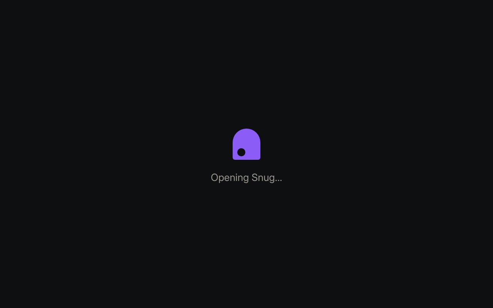

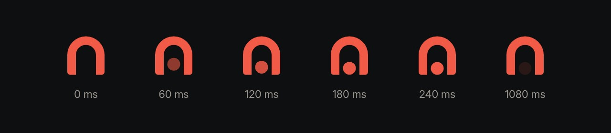

The person drops into the doorway and fades in over 240ms, rests, fades, and repeats every 1.2 seconds, always with `role="status"` and a label. A spinner says "wait"; this says "someone is arriving".

**Loops are rare and small:** breathing typing dots, a coral pulse beside "Happening now", breathing skeletons. One exception to the rule: the live pulse grows with `transform: scale`, which is neither position nor opacity. It stops under reduced motion, but it should be named as the one allowed scale.

## 24. Accessibility principles

Accessibility lives in the tokens and shared components, not in per-screen fixes.

- **Measured contrast.** `--text-3` and `--brand-press` were nudged to pass 4.5:1 where used. Coral buttons use near-black text because white fails. Light adds darker `-ink` values for mint, amber and links.
- **High contrast** follows the system or the setting.
- **Never colour alone.** Presence has shapes. Saved and starred fill. Your reactions are rose and `aria-pressed`. Mentions have an edge as well as a tint. The "New" line has a label.
- **Visible focus:** one 2px ring in the text colour, offset 2px. Not coral, because a coral ring on a coral button vanishes. Text fields break this rule: they show focus as a coral border and ring, which works on a field but is a second focus style.
- **Keyboard:** everything reachable, roving focus in lists, the rail as a toolbar with arrow keys, `?` for the full list.
- **Screen readers:** presence marks are `role="img"` with labels ("Open to talk", "In Wheel room"); loading is `role="status"`; icon buttons are named ("Join Wheel room"); Settings is a modal dialog; the current page has `aria-current`.
- **Size and density:** three text sizes scale every rem value without moving the grid; three densities change spacing.
- **Readable type:** the tailed "l", a hyperlegible mono, 16px messages with a line cap.
- **Touch:** 44px targets, bottom sheets.
- **Errors** sit under their field and clear when you type there.

## 25. Social engagement mechanics

Snug wants people to come back because their people are there, not because the app pulls at them.

**What brings people together:** presence that says what someone is open to; Home showing what is alive (or, at quiet times, who was here in the last hour); voice rooms that show who is inside; events with "3 going"; communities in common on every person surface; people you might know, only through a shared house or friend and always with the reason; previews and newcomer onboarding that lower the cost of joining; private favourites.

**What Snug deliberately does not do:**

- **No streaks.** A streak rewards opening the app, not the conversation, and punishes a week off.
- **No promotion.** No upgrade prompts, boosted communities or paid placement. Discover's stage goes to whoever has people in it now. Promotion would make every recommendation suspect.
- **No infinite feed.** Home and Discover show a fixed handful and stop. A feed is built so there is always one more thing; Snug is built so you can finish.
- **Counts only for what needs you:** direct messages, mentions, replies to you, followed threads, invitations, friend requests. Everything else is a dot or nothing. When every channel has a number, numbers become guilt; when only personal things count, you can reach zero and stop.
- **No read receipts.** No "seen by", so reading never creates a debt. Typing notices exist, because they help a live conversation and reveal nothing about who read what.
- **No strangers suggested.** Discover says so on the page.
- **No interruptions while Focused.** It all waits in Catch up.
- **No fake activity.** "It's quiet right now" is an honest state.

These choices cost some short-term engagement. They follow from the promise, "a calm place for your people", which each pull mechanic would break in a small, visible way.

## The final visual test

**Brand.** Own identity? Mostly. The Nook, arch tiles and the shape rule are not borrowed, and coral on warm charcoal is distinct from the blue and purple of the big chat apps. The frame (rail, column, content) still reads as Discord-like from across a room, because that layout suits the job. The identity lives in the details more than the structure.

**Color.** Disciplined? Largely. Surfaces carry depth and each meaning colour does one job. The weak spot is coral: it also marks "live" (the Live tag, the Happening now pulse, "Lively right now", the voice header). Live and "for you" are close, but strictly coral has two meanings. Amber picks up a second one too: the favourite star. Focused text fields also borrow coral for their border. A rail with several house badges plus the Messages badge also looks busier than the counting promise suggests, though each badge is honest.

**Layout.** Clear and stable? Yes: three fixed levels, one margin through the stream, a pane that overlays at medium widths, a separate phone product. Two visible flaws: Home's Recently here strip clips its last face with no sign that it scrolls, and the voice stage leaves an empty band above the text.

**Social.** Do real people feel present? Yes, when there is data: Home leads with people, voice shows who is in, profiles say "Wrote to you 38 min ago", Discover names who you know. An empty account is honest rather than lively.

**Personality.** Warm and slightly playful, never childish? Yes, in a narrow band: `cv11`, warm neutrals, emoji avatars, rose reactions, "Snug is better with people in it". Beyond the sign-in scene there is no illustration, and some will find it reserved.

**Density.** High information, high clarity? Yes. Home fits six conversations, a row of people, three events and a side column at 1440x900. Messages at 16px are less dense than most chat apps on purpose; Compact covers the rest.

**Restraint.** No gradients, glass, giant radii or card overload? Yes. The largest UI radius is 16px, and cards are limited to attachments, events, the Discover stage, previews and floating layers. People may choose blue or plum for their own face at low chroma; the chrome uses neither.

**Consistency.** Do the rules hold? Mostly. The shape rule holds on every screen checked, and one Message component renders rooms, threads, search results and the settings preview. Exceptions: the scaling live pulse, the wrong version in Settings, the coral focus on text fields, icon sizes off the token scale, and the contract is now out of date on presence and banners.

**Originality.** Anything new? Three things: Catch up as a triage list with one item per conversation and one policy file behind every count; presence states that say what someone is open to, each with its own shape; previews with house rules before joining. Threads in a side pane are well done, not new.

**Quality.** Finished? A carefully made 0.3. Every designed state has a token and is used, and tests cover the rules and the server with separate users. The gaps are breadth, not polish: the features below, and the few small flaws named above.

## Built since this document was written

Each works between separate people and has its own browser tests; the main README says what each covers and what could not be tested.

- **Camera video and screen sharing in voice rooms**, on the same peer-to-peer connections as audio. Faces stay for people with the camera off; a shared screen takes the large tile with the others in a strip; any tile can be focused; the desktop app has its own picker of screens and windows. Tested with Chromium's fake devices and in the desktop app under Xvfb, not with real cameras.
- **Voice messages**: hold or tap to record (up to 5 minutes), a compact player with a waveform, seeking and speed. Audio types are checked against the file's bytes.
- **Pinned messages** in rooms, direct messages and groups, with a Pin messages permission, a line in the history, a marker on the message, a count in the header and a list in the side pane.
- **GIFs**: saved GIFs on every device, GIFs posted in your places, and optional search through Tenor proxied by the server (tested against a stand-in only).
- **Custom emoji per house**, with a Manage emoji permission, a picker section, `:name:` suggestions and a `<:name:id>` token in `js/lib/format.js`.
- **Notifications when Snug is closed**: Web Push with a service worker, VAPID keys and a send path using `needsMe`, and the desktop app running in the tray. Real delivery through Google's push service could not be reached from the test machine, so a real browser push has not been seen end to end.

## Not built yet

What the brief asked for, or a person would expect, that is not in 0.3.0, and what each would need.

- **Social sign-in.** Username and password only. Needs OAuth per provider, callback routes, server secrets and account linking.
- **Email.** No verification, no "forgot password". Needs an email provider and token flows.
- **Photo avatars and community images.** The Avatar component can show an image, but nothing uploads one; house marks are a letter or emoji. Needs an upload op, cropping, resizing and storage rules.
- **Blocking and reporting.** Neither exists. Needs a block table checked in contacts, direct messages, friend requests and Discover, and a report queue for moderators.
- **Moderation beyond removal.** No bans that survive rejoining a public house, no timeouts, slow mode or audit log.
- **Privacy controls.** No setting for who may send requests or direct messages. Needs preferences enforced in `friend.request` and `dm.open`.
- **Voice device settings.** No microphone or speaker choice, level meter, push-to-talk or per-person volume. Needs `enumerateDevices`, a Voice settings page and per-peer gain.
- **TURN relay and larger rooms.** Voice and video connect directly; strict networks need a relay (`SNUG_TURN_*` is ready). Above 12 people, or more than a few cameras at once, needs a media server (SFU).
- **Calls in direct messages and groups.** Voice, camera and screen sharing exist only in voice rooms. A call to a person needs ringing, an incoming-call screen and a call state the server relays.
- **Event reminders.** Saying you are going does not notify you at the start. Needs a scheduler and a rule in `attention.js` that counts a starting event you said yes to as needing you.
- **Richer formatting.** Inline code and fenced code blocks exist; quotes, lists and spoilers do not. Needs new rules in `js/lib/format.js`.
- **A setting for the newcomer first step.** Houses choose starter rooms, but the first step (`firstStep`) is only set by seed data; every other house falls back to "Say hello". Needs a field in `house.update` and a control on the Newcomers page.
- **Native phone apps.** The phone product is the web app with a manifest. A Windows app exists; iOS and Android builds do not.
- **More than one server process.** Presence, voice membership and rate limits live in memory. Scaling past a single process needs a shared message bus.
- **The version label** in Settings, which should read 0.3.0 from one source (it is written by hand in `js/views/settings.js`).
